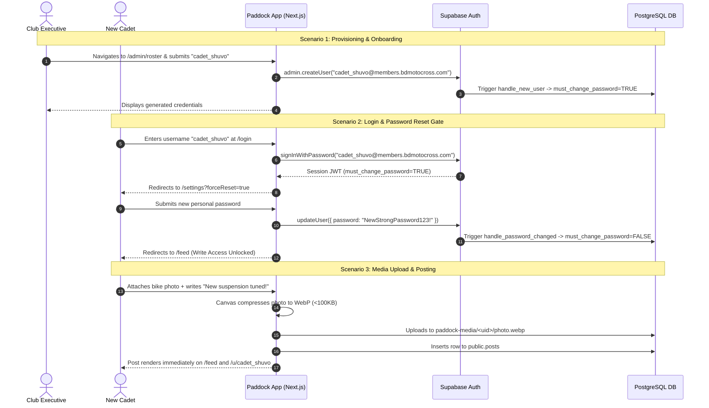
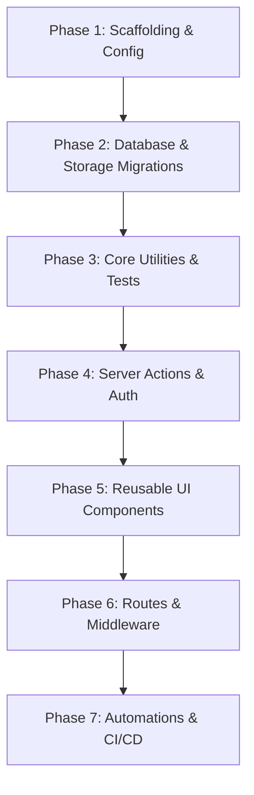

# BMCA Public Profiles & Social Platform (Paddock): PRD, Test Specs & Granular Task Matrix

> **Target Platform:** Bangladesh Motocross Club & Academy (BMCA) — Paddock Platform  
> **Destination Specification:** `docs/PRD_for_profiles.md`  
> **Architecture Reference:** `docs/architecture_for_profiles.md` (v2.1 Production-Ready)  
> **Deployment Target:** `paddock.bdmotocross.com` (Subdomain decoupled from GitHub Pages marketing site)  
> **Operating Budget:** **$0.00 / month** permanently within free tiers  
> **Execution Directive:** Designed for deterministic, step-by-step execution by an autonomous developer agent without ambiguous design leaps.

---

# TABLE OF CONTENTS
1. [PART 1: Product Requirements Document (PRD)](#part-1-product-requirements-document-prd)
   - [1.1 Executive Summary & Problem Statement](#11-executive-summary--problem-statement)
   - [1.2 User Personas & Permissions Matrix](#12-user-personas--permissions-matrix)
   - [1.3 System Boundaries (Strict Scope)](#13-system-boundaries-strict-scope)
   - [1.4 Detailed Functional Requirements (FR-01 to FR-12)](#14-detailed-functional-requirements-fr-01-to-fr-12)
   - [1.5 Non-Functional Requirements (NFR-01 to NFR-06)](#15-non-functional-requirements-nfr-01-to-nfr-06)
   - [1.6 API Contracts, Schemas & Data Formats](#16-api-contracts-schemas--data-formats)
2. [PART 2: Comprehensive Test Specifications](#part-2-comprehensive-test-specifications)
   - [2.1 Pure Utility Unit Tests](#21-pure-utility-unit-tests)
   - [2.2 PostgreSQL Schema & RLS Test Matrix](#22-postgresql-schema--rls-test-matrix)
   - [2.3 Server Action & API Route Tests](#23-server-action--api-route-tests)
   - [2.4 UI Component & Interaction Tests](#24-ui-component--interaction-tests)
   - [2.5 End-to-End (E2E) Scenario Tests](#25-end-to-end-e2e-scenario-tests)
3. [PART 3: Hyper-Granular Atomic Task Matrix (For AI Agents)](#part-3-hyper-granular-atomic-task-matrix-for-ai-agents)
   - [Phase 1: Project Scaffolding & Configuration](#phase-1-project-scaffolding--configuration)
   - [Phase 2: Database Schema, Triggers & Storage Migrations](#phase-2-database-schema-triggers--storage-migrations)
   - [Phase 3: Core Utilities & Test Suite](#phase-3-core-utilities--test-suite)
   - [Phase 4: Server Actions & Authentication Engine](#phase-4-server-actions--authentication-engine)
   - [Phase 5: Reusable UI Component Library](#phase-5-reusable-ui-component-library)
   - [Phase 6: Application Routes & Middleware](#phase-6-application-routes--middleware)
   - [Phase 7: Automations, Cron Jobs & Edge Invalidation](#phase-7-automations-cron-jobs--edge-invalidation)

---

# PART 1: Product Requirements Document (PRD)

## 1.1 Executive Summary & Problem Statement
Bangladesh Motocross Club & Academy (BMCA) currently operates a static informational website on GitHub Pages (`bdmotocross.com`). While sufficient for event countdowns and academy overviews, it cannot showcase individual racer setups, dynamic coaching profiles, event photo drops, or community discussions.

The BMCA Paddock Platform (`paddock.bdmotocross.com`) is a high-speed, zero-cost community and profile hub. It gives verified riders, cadets, mentors, and club directors an official verified identity, public vanity URLs (`/u/:username`), native WebP photo uploads, responsive YouTube video facades, and public discussion streams.

## 1.2 User Personas & Permissions Matrix

| Persona | Description | Read Access | Write Access | Moderation Access |
| :--- | :--- | :--- | :--- | :--- |
| **Public Visitor (Fan, Scout, Sponsor)** | Unauthenticated guest browsing from web or mobile | View all `/u/:username` profiles, `/feed`, posts, comments, photos, videos | None. Prompted to view or WhatsApp BMCA | None |
| **Club Cadet / Rider** | Active racing member or academy student | View all public pages | Publish posts, comments, upload bike/track photos, customize own profile bio/specs | Delete own posts & comments only |
| **Club Mentor / Coach** | Senior certified motocross trainer | View all public pages | Publish posts, comments, upload media, display coaching badges & WhatsApp hotline | Delete own posts & comments only |
| **Club Executive / Marshal** | Club director, track marshal, system admin | View all public pages | All Rider/Mentor capabilities + Provision new rider accounts trackside | **Delete ANY post or comment** on the platform |

## 1.3 System Boundaries (Strict Scope)

### In-Scope (Must Build)
- Subdomain community application deployed at `paddock.bdmotocross.com` (directory: `paddock/`).
- Canonical vanity URLs: `paddock.bdmotocross.com/u/:username` with role badges.
- Backwards-compatibility 301 redirects for `/exec/:username` and `/rider/:username` $\rightarrow$ `/u/:username`.
- Pre-provisioned user authentication using virtual email mapping (`<username>@members.bdmotocross.com`).
- Mandatory first-time password reset interceptor enforced at database RLS level.
- Native photo uploads into Supabase Storage (`paddock-media`) with client-side HTML5 Canvas WebP compression (max 1200px, quality 0.82, <120 KB).
- High-performance 16:9 widescreen YouTube embed facade with WebP thumbnail fallbacks.
- Live public chronological activity feed (`/feed`) with realtime WebSocket comment updates.
- In-post user mentions (`@username`) parsing and auto-linking.
- Mobile trackside account provisioning panel (`/admin/roster`) for executives.
- Cloudflare Edge CDN cache invalidation webhook on profile update.
- Automated GitHub Actions keep-alive ping to prevent Supabase 7-day inactivity pause.

### Strict Out-of-Scope (DO NOT BUILD)
- **NO In-App Private Chat / Direct Messaging:** 1-to-1 chats are routed to direct WhatsApp mentor links. Group announcements route to official BMCA Facebook Messenger group.
- **NO Public Open Registration:** No self-signup button. All accounts are batch-provisioned by executives.
- **NO Binary Video Hosting:** BMCA does not store MP4/MOV files. Video is exclusively handled via YouTube URL parsing.
- **NO External Fragile CDN Dependencies:** No Discord CDN links (which expire in 24 hours), no Imgur hotlinking (blocked by Imgur TOS).
- **NO E-Commerce / Payment Gateways:** Merchandise and track fees remain offline / direct cash / bKash.

---

## 1.4 Detailed Functional Requirements (FR)

### FR-01: Trackside Account Provisioning
- **Actor:** Club Executive (`role = 'exec'` or `secondary_role = 'exec'`).
- **Endpoint:** Next.js Server Action `provisionRiderAccount` at `/admin/roster`.
- **Behavior:**
  1. Verifies caller session is authenticated and holds executive privileges.
  2. Validates `username` against regex `^[a-z0-9_]{3,32}$`.
  3. Formulates virtual routing email `${username}@members.bdmotocross.com`.
  4. Calls `supabaseAdmin.auth.admin.createUser` with `email`, `tempPassword`, and metadata (`username`, `full_name`, `role`).
  5. The database trigger `handle_new_user` inserts the record into `public.profiles` with `must_change_password = TRUE`.

### FR-02: Authentication & First-Time Password Gate
- **Actor:** Provisioned Member.
- **Route:** `/login`.
- **Behavior:**
  1. Rider enters either raw username (e.g., `mr99`) or full email and temporary password.
  2. Client normalizes input: if no `@` character, appends `@members.bdmotocross.com`.
  3. Authenticates via `supabase.auth.signInWithPassword`.
  4. If `must_change_password = TRUE`, user is redirected to `/settings?forceReset=true` and all write actions (`INSERT` to posts, comments, mentions) are rejected at database level.
  5. Once rider submits new password, PostgreSQL trigger `on_auth_user_password_changed` automatically sets `must_change_password = FALSE`.

### FR-03: Unified Profile Page (`/u/:username`)
- **Actor:** Public Visitor / Authenticated Member.
- **Route:** `/u/[username]`.
- **Behavior:**
  1. Served via Next.js ISR (`revalidate = 3600`).
  2. Displays rider header: Avatar, Banner, Full Name, `@username`, Racing Number, Bike Specs (Make/Model), Bio, and dynamic role badges (`[DIRECTOR]`, `[HEAD COACH]`, `[PRO RACER]`, `[CADET]`).
  3. If mentor or executive has a WhatsApp number, displays the `MentorContactButton`.
  4. Displays chronological stream of posts created by this user.

### FR-04: Profile Editing & Role Shielding
- **Actor:** Profile Owner.
- **Route:** `/settings`.
- **Behavior:**
  1. Owner can update `full_name`, `racing_number`, `bike_model`, `bio`, `avatar_url`, `banner_url`.
     - WhatsApp number and its visibility live in `profile_contacts` (migration `0005`). Private by default: only the owner sees it until they tick "Show my WhatsApp number on my public profile".
  2. Database column-level grants and `protect_profile_system_fields` trigger reject any attempt to update `role`, `secondary_role`, or `must_change_password`.
  3. Upon save, Server Action calls `purgeEdgeProfileCache(username)` to invalidate Cloudflare and Next.js ISR caches.

### FR-05: Live Activity Feed (`/feed`)
- **Actor:** Public Visitor / Authenticated Member.
- **Route:** `/feed`.
- **Behavior:**
  1. Completely bypasses edge cache to prevent stale post synchronization anomalies.
  2. Fetches recent 50 posts with author profile details and comment count.
  3. Subscribes to Supabase Realtime channel `public:comments` for live comment badges.

### FR-06: Post Creation with Native WebP Media
- **Actor:** Active Member (`must_change_password = FALSE`).
- **Behavior:**
  1. User enters text content (up to 1,000 characters).
  2. Optional photo selection: Compressed client-side using Canvas to WebP (max 1200px, 80% quality, file size <120 KB).
  3. Uploaded to Supabase Storage bucket `paddock-media` under path `${userId}/${timestamp}.webp`.
  4. Optional YouTube link: Validated and converted to `media_type = 'youtube'` with extracted 11-character video ID.
  5. Inserts row into `public.posts`.

### FR-07: YouTube Video Facade
- **Component:** `components/YouTubeEmbed.tsx`.
- **Behavior:**
  1. Renders 16:9 container with static WebP thumbnail (`https://i.ytimg.com/vi_webp/${videoId}/maxresdefault.webp`) and fallback to `hqdefault.jpg`.
  2. Displays accessible play button with video title.
  3. Clicking play swaps facade with zero-cookie iframe (`https://www.youtube-nocookie.com/embed/${videoId}?autoplay=1&rel=0`). Zero iframe JS is downloaded until clicked.

### FR-08: Commenting & Realtime Updates
- **Actor:** Active Member (`must_change_password = FALSE`).
- **Behavior:**
  1. Member can comment on any post (max 500 characters).
  2. Row inserted into `public.comments`.
  3. Broadcasts payload over Supabase Realtime WebSocket to active feed viewers.

### FR-09: User Tagging (`@username`)
- **Actor:** Active Member writing post.
- **Behavior:**
  1. Typing `@` triggers client-side autocomplete querying `public.profiles`.
  2. On submission, regex `/@([a-z0-9_]{3,32})/g` extracts tagged handles.
  3. Valid user IDs are batch-inserted into `public.post_mentions`.
  4. Frontend post renderer parses `@username` into clickable links to `/u/:username`.

### FR-10: Content Moderation & Deletion
- **Actor:** Post Author OR Club Executive (`role = 'exec'` or `secondary_role = 'exec'`).
- **Behavior:**
  1. Delete button is visible to post author and executives.
  2. Database RLS policy allows deletion if `auth.uid() = author_id OR public.is_club_exec(auth.uid())`.
  3. Deleting a post cascades to comments and mentions.

### FR-11: 1-to-1 Mentor WhatsApp Routing
- **Component:** `components/MentorContactButton.tsx`.
- **Behavior:**
  1. Cleanly strips non-digits from mentor phone number.
  2. Formulates URI: `https://wa.me/${cleanNumber}?text=${encodedGreeting}`.
  3. Opens in new tab without leaking referrers (`rel="noopener noreferrer"`).

### FR-12: Inactivity Auto-Pause Prevention
- **System:** GitHub Actions (`.github/workflows/keep-alive.yml`).
- **Behavior:** Runs every 72 hours via cron `0 0 */3 * *`. Executes `curl` request to `${SUPABASE_URL}/rest/v1/profiles?select=id&limit=1` using anon key. Prevents Supabase 7-day free tier instance pausing.

---

## 1.5 Non-Functional Requirements (NFR)

- **NFR-01: Cost Envelope:** The entire system must operate at exactly **$0.00 / month** within the permanent free tiers of Vercel/Cloudflare Pages, Cloudflare CDN, Supabase (500 MB DB, 1 GB Storage, 50k MAU), and GitHub Actions.
- **NFR-02: Profile Read Latency:** Edge cache hit TTFB on `/u/:username` must be **< 30ms** globally through Cloudflare edge caching.
- **NFR-03: Responsive Mobile-First Design:** 100% responsive down to 320px screen width. Optimized for trackside usage on 4G cellular connections in Bangladesh.
- **NFR-04: Security & Zero-Trust RLS:** No client can elevate roles or bypass password changes. Even with compromised anon keys or leaked user tokens, PostgreSQL RLS blocks privilege escalation.
- **NFR-05: Web Performance:** Google Lighthouse score **>= 95** on Performance, Accessibility, and Best Practices. No third-party tracking scripts or heavy iframes loaded upfront.
- **NFR-06: Media Budget:** Maximum image payload size after compression is **120 KB**. No raw multi-megabyte camera uploads allowed into Supabase Storage.

---

## 1.6 API Contracts, Schemas & Data Formats

### 1.6.1 Server Action: `provisionRiderAccount`
- **Method:** Next.js Server Action
- **Input (FormData):**
  - `username`: `string` (must match `/^[a-z0-9_]{3,32}$/`)
  - `fullName`: `string` (1 to 100 chars)
  - `role`: `'exec' | 'mentor' | 'pro_racer' | 'cadet' | 'rider'`
  - `tempPassword`: `string` (minimum 8 characters)
- **Output Success:** `{ success: true, username: string, tempPassword: string }`
- **Output Error:** Throws `Error(message)`:
  - `"Unauthorized"` (if no valid session)
  - `"Forbidden: Executive authority required."` (if not exec)
  - `"Invalid username. Use 3-32 lowercase letters, numbers, or underscores."`

### 1.6.2 Server Action: `purgeEdgeProfileCache`
- **Method:** Next.js Server Action
- **Input:** `username: string`
- **Output:** `void` (logs error on failure, silent on success)
- **Side Effects:**
  1. Calls `revalidatePath('/u/[username]')`.
  2. Calls Cloudflare Purge API:
     - URL: `https://api.cloudflare.com/client/v4/zones/${CLOUDFLARE_ZONE_ID}/purge_cache`
     - Header: `Authorization: Bearer ${CLOUDFLARE_API_TOKEN}`
     - Body: `{ "files": ["https://paddock.bdmotocross.com/u/<username>"] }`

---

# PART 2: Comprehensive Test Specifications

## 2.1 Pure Utility Unit Tests (`test/unit/`)

### Test Suite: `test/unit/validation.test.ts`
1. `validateUsername("mr99")` $\rightarrow$ `true`
2. `validateUsername("baundal_bulbul")` $\rightarrow$ `true`
3. `validateUsername("ab")` $\rightarrow$ `false` (under 3 chars)
4. `validateUsername("this_username_is_way_too_long_for_bmca_profiles")` $\rightarrow$ `false` (>32 chars)
5. `validateUsername("MR99")` $\rightarrow$ `false` (uppercase not allowed by regex)
6. `validateUsername("mr-99")` $\rightarrow$ `false` (hyphen not allowed)
7. `validateUsername("mr 99")` $\rightarrow$ `false` (spaces not allowed)
8. `resolveUserEmail("mr99")` $\rightarrow$ `"mr99@members.bdmotocross.com"`
9. `resolveUserEmail("rider@gmail.com")` $\rightarrow$ `"rider@gmail.com"` (preserves explicit emails)

### Test Suite: `test/unit/youtube.test.ts`
1. `extractYouTubeId("https://www.youtube.com/watch?v=dQw4w9WgXcQ")` $\rightarrow$ `"dQw4w9WgXcQ"`
2. `extractYouTubeId("https://youtu.be/dQw4w9WgXcQ")` $\rightarrow$ `"dQw4w9WgXcQ"`
3. `extractYouTubeId("https://www.youtube.com/embed/dQw4w9WgXcQ")` $\rightarrow$ `"dQw4w9WgXcQ"`
4. `extractYouTubeId("https://www.youtube.com/watch?v=dQw4w9WgXcQ&t=42s")` $\rightarrow$ `"dQw4w9WgXcQ"`
5. `extractYouTubeId("https://notyoutube.com/video")` $\rightarrow$ `null`
6. `extractYouTubeId("")` $\rightarrow$ `null`

### Test Suite: `test/unit/mentions.test.ts`
1. `extractMentions("Great race with @mr99 and @sharif_05 today!")` $\rightarrow$ `["mr99", "sharif_05"]`
2. `extractMentions("Solo practice session, no tags.")` $\rightarrow$ `[]`
3. `extractMentions("Email me at test@bdmotocross.com")` $\rightarrow$ `[]` (does not match email addresses as mentions)

---

## 2.2 PostgreSQL Schema & RLS Test Matrix (`test/db/`)

| Test ID | Scenario | Acting Role | Operation | Target Table | Expected Result |
| :--- | :--- | :--- | :--- | :--- | :--- |
| **TC-DB-01** | Public user reads profiles | `anon` | `SELECT` | `public.profiles` | **ALLOW** (Returns all profiles) |
| **TC-DB-02** | Active rider creates post | `authenticated` (`must_change_password=FALSE`) | `INSERT` | `public.posts` | **ALLOW** (Row inserted) |
| **TC-DB-03** | Unverified rider creates post | `authenticated` (`must_change_password=TRUE`) | `INSERT` | `public.posts` | **DENY** (RLS policy rejects) |
| **TC-DB-04** | Rider attempts to update own `role` to `'exec'` | `authenticated` | `UPDATE` | `public.profiles` | **DENY** (Column grant / Trigger raises exception) |
| **TC-DB-05** | Rider attempts to set `must_change_password=FALSE` directly | `authenticated` | `UPDATE` | `public.profiles` | **DENY** (Column grant / Trigger raises exception) |
| **TC-DB-06** | Rider updates password via Supabase Auth | `auth.users` trigger | `UPDATE` | `auth.users` | **ALLOW** (`profiles.must_change_password` flips to `FALSE`) |
| **TC-DB-07** | Rider updates own `bio` and `bike_model` | `authenticated` | `UPDATE` | `public.profiles` | **ALLOW** (Permitted columns updated) |
| **TC-DB-08** | Author deletes own post | `authenticated` (`auth.uid() = author_id`) | `DELETE` | `public.posts` | **ALLOW** (Post deleted) |
| **TC-DB-09** | Executive deletes another rider's post | `authenticated` (`role = 'exec'`) | `DELETE` | `public.posts` | **ALLOW** (Moderation delete succeeds) |
| **TC-DB-10** | Regular rider deletes another rider's post | `authenticated` (`role = 'rider'`) | `DELETE` | `public.posts` | **DENY** (RLS rejects deletion) |
| **TC-DB-11** | Unauthenticated user uploads to storage bucket | `anon` | `INSERT` | `storage.objects` | **DENY** (RLS rejects upload) |
| **TC-DB-12** | Active rider uploads WebP to own folder | `authenticated` (`must_change_password=FALSE`) | `INSERT` | `storage.objects` | **ALLOW** (File stored in `paddock-media/<uid>/`) |
| **TC-DB-13** | Rider attempts upload to another rider's folder | `authenticated` | `INSERT` | `storage.objects` | **DENY** (Folder owner check fails) |

---

## 2.3 Server Action & API Route Tests

### Test Suite: `test/actions/provisionRider.test.ts`
- **TC-SA-01 (Anonymous Invocation):** Invoke `provisionRiderAccount(formData)` without session $\rightarrow$ Throws error matching `/Unauthorized/`.
- **TC-SA-02 (Unauthorized Cadet):** Invoke `provisionRiderAccount` with user whose profile has `role = 'cadet'` $\rightarrow$ Throws error matching `/Forbidden: Executive authority required/`.
- **TC-SA-03 (Invalid Username Characters):** Invoke as exec with `username = "bad-username!"` $\rightarrow$ Throws error matching `/Invalid username/`.
- **TC-SA-04 (Success Flow):** Invoke as exec with `username = "test_rider"`, `fullName = "Test Cadet"`, `role = "cadet"`, `tempPassword = "TempPass123!"` $\rightarrow$ Returns `{ success: true, username: "test_rider", tempPassword: "TempPass123!" }` and verifies user exists in Supabase Auth.

---

## 2.4 UI Component & Interaction Tests

### Test Suite: `test/components/YouTubeEmbed.test.tsx`
- **TC-UI-01:** Renders facade with `img` src matching `https://i.ytimg.com/vi_webp/dQw4w9WgXcQ/maxresdefault.webp`.
- **TC-UI-02:** No `<iframe>` is present in the DOM on initial render.
- **TC-UI-03:** Clicking the play button replaces the facade with an `<iframe>` containing `autoplay=1&rel=0`.
- **TC-UI-04:** If thumbnail triggers `onError`, source falls back to `https://img.youtube.com/vi/dQw4w9WgXcQ/hqdefault.jpg`.

### Test Suite: `test/components/MentorContactButton.test.tsx`
- **TC-UI-05:** Passes `whatsappNumber = "+880 1975-376114"` $\rightarrow$ `href` attribute equals `https://wa.me/8801975376114?text=Hello%20BMCA%2C%20I%20would%20like%20to%20book%20a%20coaching%20session%20with%20mentor%20Bulbul.`
- **TC-UI-06:** Renders with `target="_blank"` and `rel="noopener noreferrer"`.

---

## 2.5 End-to-End (E2E) Scenario Tests (`test/e2e/`)



---

# PART 3: Hyper-Granular Atomic Task Matrix (For AI Agents)

> **Agent Instruction:** Execute each task sequentially. Do not combine tasks. Do not alter file paths. Run the verification command after completing each task; do not proceed if verification fails.



---

## Phase 1: Project Scaffolding & Configuration

### Task 1.1: Initialize Next.js 15 Project Directory
- **Task ID:** `TASK-01.1`
- **Location:** Project root (`/`)
- **Preconditions:** Node.js 20+ installed.
- **Action:**
  Run from root directory:
  ```bash
  npx create-next-app@latest paddock --typescript --tailwind --eslint --app --src-dir=false --import-alias="@/*" --use-npm --no-turbopack
  ```
- **Verification Command:**
  ```bash
  test -f paddock/package.json && test -f paddock/app/layout.tsx && echo "SUCCESS"
  ```
- **Definition of Done:** Directory `paddock/` exists with Next.js 15 App Router structure and outputs `"SUCCESS"`.

---

### Task 1.2: Install Production Dependencies
- **Task ID:** `TASK-01.2`
- **Location:** `paddock/`
- **Preconditions:** `TASK-01.1` completed.
- **Action:**
  Run inside `paddock/`:
  ```bash
  cd paddock && npm install @supabase/supabase-js @supabase/ssr lucide-react clsx tailwind-merge
  ```
- **Verification Command:**
  ```bash
  cd paddock && node -e "require('@supabase/supabase-js'); require('@supabase/ssr'); require('lucide-react'); console.log('DEPS_OK')"
  ```
- **Definition of Done:** Command prints `DEPS_OK`.

---

### Task 1.3: Install Test Runner (Vitest + Testing Library)
- **Task ID:** `TASK-01.3`
- **Location:** `paddock/`
- **Preconditions:** `TASK-01.2` completed.
- **Action:**
  Run inside `paddock/`:
  ```bash
  cd paddock && npm install -D vitest @vitejs/plugin-react jsdom @testing-library/react @testing-library/jest-dom
  ```
  Create file `paddock/vitest.config.ts`:
  ```typescript
  import { defineConfig } from "vitest/config";
  import react from "@vitejs/plugin-react";
  import path from "path";

  export default defineConfig({
    plugins: [react()],
    test: {
      environment: "jsdom",
      globals: true,
      setupFiles: ["./test/setup.ts"],
    },
    resolve: {
      alias: {
        "@": path.resolve(__dirname, "./"),
      },
    },
  });
  ```
  Create file `paddock/test/setup.ts`:
  ```typescript
  import "@testing-library/jest-dom";
  ```
  Update `paddock/package.json` scripts:
  ```json
  "test": "vitest run"
  ```
- **Verification Command:**
  ```bash
  cd paddock && npm run test -- --passWithNoTests
  ```
- **Definition of Done:** Vitest runs and exits with code 0.

---

### Task 1.4: Configure Environment Variables
- **Task ID:** `TASK-01.4`
- **Location:** `paddock/`
- **Preconditions:** `TASK-01.1` completed.
- **Action:**
  Create file `paddock/.env.example`:
  ```env
  NEXT_PUBLIC_SUPABASE_URL=https://your-project.supabase.co
  NEXT_PUBLIC_SUPABASE_ANON_KEY=your-anon-key
  SUPABASE_SERVICE_ROLE_KEY=your-service-role-key
  CLOUDFLARE_ZONE_ID=your-cloudflare-zone-id
  CLOUDFLARE_API_TOKEN=your-cloudflare-api-token
  NEXT_PUBLIC_APP_DOMAIN=paddock.bdmotocross.com
  ```
  Copy `.env.example` to `paddock/.env.local` for local development.
- **Verification Command:**
  ```bash
  test -f paddock/.env.example && test -f paddock/.env.local && echo "ENV_OK"
  ```
- **Definition of Done:** Command outputs `ENV_OK`.

---

## Phase 2: Database Schema, Triggers & Storage Migrations

### Task 2.1: Create SQL DDL Migration File
- **Task ID:** `TASK-02.1`
- **Location:** `paddock/supabase/migrations/20261115000001_initial_schema.sql`
- **Preconditions:** Directory `paddock/supabase/migrations/` created.
- **Action:**
  Create file `paddock/supabase/migrations/20261115000001_initial_schema.sql`:
  ```sql
  -- 1. Enums
  CREATE TYPE user_role AS ENUM ('exec', 'mentor', 'pro_racer', 'cadet', 'rider');
  CREATE TYPE media_type AS ENUM ('none', 'image', 'youtube');

  -- 2. Profiles Table
  CREATE TABLE public.profiles (
      id UUID PRIMARY KEY REFERENCES auth.users(id) ON DELETE CASCADE,
      username VARCHAR(32) NOT NULL UNIQUE CHECK (username ~ '^[a-z0-9_]{3,32}$'),
      full_name VARCHAR(100) NOT NULL,
      role user_role NOT NULL DEFAULT 'rider',
      secondary_role user_role NULL,
      racing_number VARCHAR(10),
      bike_model VARCHAR(100),
      bio TEXT DEFAULT '',
      avatar_url TEXT DEFAULT '',
      banner_url TEXT DEFAULT '',
      whatsapp_number VARCHAR(20),
      must_change_password BOOLEAN NOT NULL DEFAULT TRUE,
      created_at TIMESTAMPTZ NOT NULL DEFAULT timezone('utc'::text, now()),
      updated_at TIMESTAMPTZ NOT NULL DEFAULT timezone('utc'::text, now())
  );

  CREATE INDEX idx_profiles_role ON public.profiles (role);

  -- 3. Posts Table
  CREATE TABLE public.posts (
      id UUID PRIMARY KEY DEFAULT gen_random_uuid(),
      author_id UUID NOT NULL REFERENCES public.profiles(id) ON DELETE CASCADE,
      content TEXT NOT NULL CHECK (char_length(content) <= 1000),
      media_type media_type NOT NULL DEFAULT 'none',
      media_url TEXT DEFAULT '',
      created_at TIMESTAMPTZ NOT NULL DEFAULT timezone('utc'::text, now())
  );

  CREATE INDEX idx_posts_created_at ON public.posts (created_at DESC);
  CREATE INDEX idx_posts_author ON public.posts (author_id);

  -- 4. Comments Table
  CREATE TABLE public.comments (
      id UUID PRIMARY KEY DEFAULT gen_random_uuid(),
      post_id UUID NOT NULL REFERENCES public.posts(id) ON DELETE CASCADE,
      author_id UUID NOT NULL REFERENCES public.profiles(id) ON DELETE CASCADE,
      content TEXT NOT NULL CHECK (char_length(content) <= 500),
      created_at TIMESTAMPTZ NOT NULL DEFAULT timezone('utc'::text, now())
  );

  CREATE INDEX idx_comments_post_id ON public.comments (post_id, created_at ASC);

  -- 5. Post Mentions Table
  CREATE TABLE public.post_mentions (
      post_id UUID NOT NULL REFERENCES public.posts(id) ON DELETE CASCADE,
      user_id UUID NOT NULL REFERENCES public.profiles(id) ON DELETE CASCADE,
      created_at TIMESTAMPTZ NOT NULL DEFAULT timezone('utc'::text, now()),
      PRIMARY KEY (post_id, user_id)
  );

  CREATE INDEX idx_mentions_user ON public.post_mentions (user_id);
  ```
- **Verification Command:**
  ```bash
  grep -q "idx_mentions_user" paddock/supabase/migrations/20261115000001_initial_schema.sql && echo "SCHEMA_MIGRATION_OK"
  ```
- **Definition of Done:** Command outputs `SCHEMA_MIGRATION_OK`.

---

### Task 2.2: Create SQL Triggers & Security Definer Functions
- **Task ID:** `TASK-02.2`
- **Location:** `paddock/supabase/migrations/20261115000002_triggers_and_functions.sql`
- **Preconditions:** `TASK-02.1` completed.
- **Action:**
  Create file `paddock/supabase/migrations/20261115000002_triggers_and_functions.sql`:
  ```sql
  -- 1. Automated New User Profile Provisioning Trigger
  CREATE OR REPLACE FUNCTION public.handle_new_user()
  RETURNS trigger AS $$
  BEGIN
    INSERT INTO public.profiles (
      id,
      username,
      full_name,
      role,
      must_change_password
    )
    VALUES (
      new.id,
      LOWER(COALESCE(NULLIF(new.raw_user_meta_data->>'username', ''), 'rider_' || SUBSTRING(new.id::text, 1, 8))),
      COALESCE(NULLIF(new.raw_user_meta_data->>'full_name', ''), 'BMCA Member'),
      COALESCE(NULLIF(new.raw_app_meta_data->>'role', '')::user_role, 'rider'::user_role),
      TRUE
    );
    RETURN new;
  END;
  $$ LANGUAGE plpgsql SECURITY DEFINER;

  CREATE TRIGGER on_auth_user_created
    AFTER INSERT ON auth.users
    FOR EACH ROW EXECUTE PROCEDURE public.handle_new_user();

  -- 2. Automated Password Reset Unlocking Trigger
  CREATE OR REPLACE FUNCTION public.handle_password_changed()
  RETURNS trigger AS $$
  BEGIN
    IF (OLD.encrypted_password IS DISTINCT FROM NEW.encrypted_password) THEN
      UPDATE public.profiles
      SET must_change_password = FALSE
      WHERE id = NEW.id;
    END IF;
    RETURN NEW;
  END;
  $$ LANGUAGE plpgsql SECURITY DEFINER;

  CREATE TRIGGER on_auth_user_password_changed
    AFTER UPDATE OF encrypted_password ON auth.users
    FOR EACH ROW EXECUTE PROCEDURE public.handle_password_changed();

  -- 3. System Fields Protection Trigger
  CREATE OR REPLACE FUNCTION public.protect_profile_system_fields()
  RETURNS trigger AS $$
  BEGIN
    IF (NEW.role IS DISTINCT FROM OLD.role) OR 
       (NEW.secondary_role IS DISTINCT FROM OLD.secondary_role) OR 
       (NEW.must_change_password IS DISTINCT FROM OLD.must_change_password) THEN
      IF (current_setting('request.jwt.claim.role', true) != 'service_role') THEN
        RAISE EXCEPTION 'Unauthorized attempt to modify protected system fields.';
      END IF;
    END IF;
    NEW.updated_at = timezone('utc'::text, now());
    RETURN NEW;
  END;
  $$ LANGUAGE plpgsql SECURITY DEFINER;

  CREATE TRIGGER trg_protect_profile_system_fields
    BEFORE UPDATE ON public.profiles
    FOR EACH ROW EXECUTE PROCEDURE public.protect_profile_system_fields();

  -- 4. Permission Helpers
  CREATE OR REPLACE FUNCTION public.is_active_member(user_id UUID)
  RETURNS BOOLEAN AS $$
    SELECT EXISTS (
      SELECT 1 FROM public.profiles
      WHERE id = user_id AND must_change_password = FALSE
    );
  $$ LANGUAGE sql SECURITY DEFINER STABLE;

  CREATE OR REPLACE FUNCTION public.is_club_exec(user_id UUID)
  RETURNS BOOLEAN AS $$
    SELECT EXISTS (
      SELECT 1 FROM public.profiles
      WHERE id = user_id AND (role = 'exec' OR secondary_role = 'exec')
    );
  $$ LANGUAGE sql SECURITY DEFINER STABLE;
  ```
- **Verification Command:**
  ```bash
  grep -q "protect_profile_system_fields" paddock/supabase/migrations/20261115000002_triggers_and_functions.sql && echo "TRIGGERS_OK"
  ```
- **Definition of Done:** Command outputs `TRIGGERS_OK`.

---

### Task 2.3: Create Row-Level Security (RLS) & Column Grants Migration
- **Task ID:** `TASK-02.3`
- **Location:** `paddock/supabase/migrations/20261115000003_rls_and_storage.sql`
- **Preconditions:** `TASK-02.2` completed.
- **Action:**
  Create file `paddock/supabase/migrations/20261115000003_rls_and_storage.sql`:
  ```sql
  -- 1. Enable RLS
  ALTER TABLE public.profiles ENABLE ROW LEVEL SECURITY;
  ALTER TABLE public.posts ENABLE ROW LEVEL SECURITY;
  ALTER TABLE public.comments ENABLE ROW LEVEL SECURITY;
  ALTER TABLE public.post_mentions ENABLE ROW LEVEL SECURITY;

  -- 2. Column Grants
  REVOKE UPDATE ON public.profiles FROM authenticated;
  GRANT UPDATE (full_name, racing_number, bike_model, bio, avatar_url, banner_url, whatsapp_number)
  ON public.profiles TO authenticated;

  -- 3. Profiles Policies
  CREATE POLICY "Public read access for profiles"
  ON public.profiles FOR SELECT USING (true);

  CREATE POLICY "Users can update permitted fields on own profile"
  ON public.profiles FOR UPDATE TO authenticated
  USING (auth.uid() = id)
  WITH CHECK (auth.uid() = id);

  -- 4. Posts Policies
  CREATE POLICY "Public read access for posts"
  ON public.posts FOR SELECT USING (true);

  CREATE POLICY "Active members can create posts"
  ON public.posts FOR INSERT TO authenticated
  WITH CHECK (
    auth.uid() = author_id 
    AND public.is_active_member(auth.uid())
  );

  CREATE POLICY "Authors and Admins can delete posts"
  ON public.posts FOR DELETE TO authenticated
  USING (
    auth.uid() = author_id 
    OR public.is_club_exec(auth.uid())
  );

  -- 5. Comments Policies
  CREATE POLICY "Public read access for comments"
  ON public.comments FOR SELECT USING (true);

  CREATE POLICY "Active members can post comments"
  ON public.comments FOR INSERT TO authenticated
  WITH CHECK (
    auth.uid() = author_id 
    AND public.is_active_member(auth.uid())
  );

  CREATE POLICY "Authors and Admins can delete comments"
  ON public.comments FOR DELETE TO authenticated
  USING (
    auth.uid() = author_id 
    OR public.is_club_exec(auth.uid())
  );

  -- 6. Mentions Policies
  CREATE POLICY "Public read access for mentions"
  ON public.post_mentions FOR SELECT USING (true);

  CREATE POLICY "Post authors can link mentions"
  ON public.post_mentions FOR INSERT TO authenticated
  WITH CHECK (
    EXISTS (
      SELECT 1 FROM public.posts 
      WHERE id = post_id AND author_id = auth.uid()
    )
  );

  -- 7. Supabase Storage Bucket & RLS
  INSERT INTO storage.buckets (id, name, public, file_size_limit, allowed_mime_types)
  VALUES ('paddock-media', 'paddock-media', true, 2097152, ARRAY['image/webp', 'image/jpeg', 'image/png'])
  ON CONFLICT (id) DO NOTHING;

  CREATE POLICY "Public read for paddock media"
  ON storage.objects FOR SELECT USING (bucket_id = 'paddock-media');

  CREATE POLICY "Active members can upload paddock media"
  ON storage.objects FOR INSERT TO authenticated
  WITH CHECK (
    bucket_id = 'paddock-media' 
    AND public.is_active_member(auth.uid())
    AND (storage.foldername(name))[1] = auth.uid()::text
  );

  CREATE POLICY "Authors can delete their uploaded media"
  ON storage.objects FOR DELETE TO authenticated
  USING (
    bucket_id = 'paddock-media' 
    AND (storage.foldername(name))[1] = auth.uid()::text
  );
  ```
- **Verification Command:**
  ```bash
  grep -q "paddock-media" paddock/supabase/migrations/20261115000003_rls_and_storage.sql && echo "RLS_MIGRATION_OK"
  ```
- **Definition of Done:** Command outputs `RLS_MIGRATION_OK`.

---

## Phase 3: Core Utilities & Test Suite

### Task 3.1: Username Validation & Virtual Email Utilities
- **Task ID:** `TASK-03.1`
- **Location:** `paddock/utils/validation.ts`
- **Preconditions:** `TASK-01.1` completed.
- **Action:**
  Create file `paddock/utils/validation.ts`:
  ```typescript
  export const USERNAME_REGEX = /^[a-z0-9_]{3,32}$/;

  export function validateUsername(username: string): boolean {
    if (!username) return false;
    return USERNAME_REGEX.test(username.trim());
  }

  export function resolveUserEmail(input: string): string {
    const trimmed = input.trim().toLowerCase();
    if (trimmed.includes("@")) {
      return trimmed;
    }
    return `${trimmed}@members.bdmotocross.com`;
  }
  ```
  Create unit test file `paddock/test/unit/validation.test.ts`:
  ```typescript
  import { describe, it, expect } from "vitest";
  import { validateUsername, resolveUserEmail } from "@/utils/validation";

  describe("Validation Utilities", () => {
    it("validates compliant usernames", () => {
      expect(validateUsername("mr99")).toBe(true);
      expect(validateUsername("baundal_bulbul")).toBe(true);
      expect(validateUsername("sharif_05")).toBe(true);
    });

    it("rejects non-compliant usernames", () => {
      expect(validateUsername("ab")).toBe(false); // too short
      expect(validateUsername("a".repeat(33))).toBe(false); // too long
      expect(validateUsername("MR99")).toBe(false); // uppercase
      expect(validateUsername("mr-99")).toBe(false); // hyphen
      expect(validateUsername("mr 99")).toBe(false); // space
      expect(validateUsername("mr.99")).toBe(false); // dot
    });

    it("resolves virtual emails", () => {
      expect(resolveUserEmail("mr99")).toBe("mr99@members.bdmotocross.com");
      expect(resolveUserEmail("rider@gmail.com")).toBe("rider@gmail.com");
    });
  });
  ```
- **Verification Command:**
  ```bash
  cd paddock && npx vitest run test/unit/validation.test.ts
  ```
- **Definition of Done:** Vitest passes all tests with exit code 0.

---

### Task 3.2: YouTube Video ID Extractor Utility
- **Task ID:** `TASK-03.2`
- **Location:** `paddock/utils/youtube.ts`
- **Preconditions:** `TASK-01.1` completed.
- **Action:**
  Create file `paddock/utils/youtube.ts`:
  ```typescript
  export function extractYouTubeId(url: string): string | null {
    if (!url) return null;
    const cleanUrl = url.trim();
    const pattern = /(?:youtube\.com\/(?:[^\/]+\/.+\/|(?:v|e(?:mbed)?)\/|.*[?&]v=)|youtu\.be\/)([^"&?\/\s]{11})/;
    const match = cleanUrl.match(pattern);
    return match ? match[1] : null;
  }
  ```
  Create test file `paddock/test/unit/youtube.test.ts`:
  ```typescript
  import { describe, it, expect } from "vitest";
  import { extractYouTubeId } from "@/utils/youtube";

  describe("YouTube ID Extractor", () => {
    it("extracts ID from standard watch URL", () => {
      expect(extractYouTubeId("https://www.youtube.com/watch?v=dQw4w9WgXcQ")).toBe("dQw4w9WgXcQ");
    });

    it("extracts ID from short youtu.be URL", () => {
      expect(extractYouTubeId("https://youtu.be/dQw4w9WgXcQ")).toBe("dQw4w9WgXcQ");
    });

    it("extracts ID from embed URL", () => {
      expect(extractYouTubeId("https://www.youtube.com/embed/dQw4w9WgXcQ")).toBe("dQw4w9WgXcQ");
    });

    it("returns null for non-YouTube links", () => {
      expect(extractYouTubeId("https://vimeo.com/123456")).toBeNull();
      expect(extractYouTubeId("")).toBeNull();
    });
  });
  ```
- **Verification Command:**
  ```bash
  cd paddock && npx vitest run test/unit/youtube.test.ts
  ```
- **Definition of Done:** Vitest passes all tests with exit code 0.

---

### Task 3.3: Mentions Parser Utility
- **Task ID:** `TASK-03.3`
- **Location:** `paddock/utils/mentions.ts`
- **Preconditions:** `TASK-01.1` completed.
- **Action:**
  Create file `paddock/utils/mentions.ts`:
  ```typescript
  export function extractMentions(text: string): string[] {
    if (!text) return [];
    // Matches @username preceded by whitespace or start of string, avoiding emails
    const matches = text.match(/(?:^|\s)@([a-z0-9_]{3,32})\b/gi);
    if (!matches) return [];
    const handles = matches.map((m) => m.trim().replace(/^@/, "").toLowerCase());
    return Array.from(new Set(handles));
  }
  ```
  Create test file `paddock/test/unit/mentions.test.ts`:
  ```typescript
  import { describe, it, expect } from "vitest";
  import { extractMentions } from "@/utils/mentions";

  describe("Mentions Parser", () => {
    it("extracts unique mentions", () => {
      const text = "Great laps with @mr99 and @sharif_05! Mentioning @mr99 again.";
      expect(extractMentions(text)).toEqual(["mr99", "sharif_05"]);
    });

    it("ignores emails", () => {
      const text = "Contact me at info@bdmotocross.com for gates.";
      expect(extractMentions(text)).toEqual([]);
    });

    it("handles empty or tagless text", () => {
      expect(extractMentions("Solo practice today")).toEqual([]);
      expect(extractMentions("")).toEqual([]);
    });
  });
  ```
- **Verification Command:**
  ```bash
  cd paddock && npx vitest run test/unit/mentions.test.ts
  ```
- **Definition of Done:** Vitest passes all tests with exit code 0.

---

### Task 3.4: Client-Side Canvas WebP Image Compressor
- **Task ID:** `TASK-03.4`
- **Location:** `paddock/utils/compressImage.ts`
- **Preconditions:** `TASK-01.1` completed.
- **Action:**
  Create file `paddock/utils/compressImage.ts`:
  ```typescript
  export async function compressRiderImage(file: File): Promise<Blob> {
    return new Promise((resolve, reject) => {
      if (!file.type.startsWith("image/")) {
        return reject(new Error("Selected file must be an image."));
      }

      const img = new Image();
      const objectUrl = URL.createObjectURL(file);
      img.src = objectUrl;

      img.onload = () => {
        URL.revokeObjectURL(objectUrl);
        const canvas = document.createElement("canvas");
        const MAX_SIZE = 1200;
        let width = img.width;
        let height = img.height;

        if (width > height && width > MAX_SIZE) {
          height = Math.round((height * MAX_SIZE) / width);
          width = MAX_SIZE;
        } else if (height > MAX_SIZE) {
          width = Math.round((width * MAX_SIZE) / height);
          height = MAX_SIZE;
        }

        canvas.width = width;
        canvas.height = height;
        const ctx = canvas.getContext("2d");
        if (!ctx) return reject(new Error("Canvas context creation failed."));

        ctx.drawImage(img, 0, 0, width, height);

        canvas.toBlob(
          (blob) => {
            if (blob) resolve(blob);
            else reject(new Error("Canvas compression failed."));
          },
          "image/webp",
          0.82
        );
      };

      img.onerror = () => {
        URL.revokeObjectURL(objectUrl);
        reject(new Error("Failed to load image for compression."));
      };
    });
  }
  ```
- **Verification Command:**
  ```bash
  grep -q "compressRiderImage" paddock/utils/compressImage.ts && echo "COMPRESS_OK"
  ```
- **Definition of Done:** Command outputs `COMPRESS_OK`.

---

### Task 3.5: Supabase Client Factories
- **Task ID:** `TASK-03.5`
- **Location:** `paddock/utils/supabase/`
- **Preconditions:** `TASK-01.2` completed.
- **Action:**
  Create directory `paddock/utils/supabase/`.
  
  Create file `paddock/utils/supabase/client.ts` (Browser Client):
  ```typescript
  import { createBrowserClient } from "@supabase/ssr";

  export function createClient() {
    return createBrowserClient(
      process.env.NEXT_PUBLIC_SUPABASE_URL!,
      process.env.NEXT_PUBLIC_SUPABASE_ANON_KEY!
    );
  }
  ```

  Create file `paddock/utils/supabase/server.ts` (Server Component & Server Action Client):
  ```typescript
  import { createServerClient } from "@supabase/ssr";
  import { cookies } from "next/headers";

  export async function createClient() {
    const cookieStore = await cookies();

    return createServerClient(
      process.env.NEXT_PUBLIC_SUPABASE_URL!,
      process.env.NEXT_PUBLIC_SUPABASE_ANON_KEY!,
      {
        cookies: {
          getAll() {
            return cookieStore.getAll();
          },
          setAll(cookiesToSet) {
            try {
              cookiesToSet.forEach(({ name, value, options }) =>
                cookieStore.set(name, value, options)
              );
            } catch {
              // Ignore in Server Components
            }
          },
        },
      }
    );
  }
  ```

  Create file `paddock/utils/supabase/admin.ts` (Service Role Admin Client):
  ```typescript
  import { createClient } from "@supabase/supabase-js";

  export const supabaseAdmin = createClient(
    process.env.NEXT_PUBLIC_SUPABASE_URL!,
    process.env.SUPABASE_SERVICE_ROLE_KEY!
  );
  ```
- **Verification Command:**
  ```bash
  test -f paddock/utils/supabase/client.ts && test -f paddock/utils/supabase/server.ts && test -f paddock/utils/supabase/admin.ts && echo "CLIENTS_OK"
  ```
- **Definition of Done:** Command outputs `CLIENTS_OK`.

---

## Phase 4: Server Actions & Authentication Engine

### Task 4.1: Trackside Provisioning Server Action
- **Task ID:** `TASK-04.1`
- **Location:** `paddock/app/actions/provisionRider.ts`
- **Preconditions:** `TASK-03.1` and `TASK-03.5` completed.
- **Action:**
  Create file `paddock/app/actions/provisionRider.ts`:
  ```typescript
  "use server";

  import { createClient } from "@/utils/supabase/server";
  import { supabaseAdmin } from "@/utils/supabase/admin";
  import { validateUsername } from "@/utils/validation";
  import { revalidatePath } from "next/cache";

  export async function provisionRiderAccount(formData: FormData) {
    // 1. Authenticate caller session & enforce executive authority
    const supabase = await createClient();
    const { data: { user } } = await supabase.auth.getUser();
    if (!user) throw new Error("Unauthorized");

    const { data: caller } = await supabase
      .from("profiles")
      .select("role, secondary_role")
      .eq("id", user.id)
      .single();

    if (caller?.role !== "exec" && caller?.secondary_role !== "exec") {
      throw new Error("Forbidden: Executive authority required.");
    }

    // 2. Validate and sanitize inputs
    const rawUsername = (formData.get("username") as string).toLowerCase().trim();
    if (!validateUsername(rawUsername)) {
      throw new Error("Invalid username. Use 3-32 lowercase letters, numbers, or underscores.");
    }

    const fullName = (formData.get("fullName") as string)?.trim() || "BMCA Member";
    const role = (formData.get("role") as string) || "rider";
    const tempPassword = formData.get("tempPassword") as string;
    if (!tempPassword || tempPassword.length < 8) {
      throw new Error("Temporary password must be at least 8 characters.");
    }

    const email = `${rawUsername}@members.bdmotocross.com`;

    // 3. Create auth user with service_role privileges
    const { data: newUser, error: authError } = await supabaseAdmin.auth.admin.createUser({
      email,
      password: tempPassword,
      email_confirm: true,
      user_metadata: { username: rawUsername, full_name: fullName },
      app_metadata: { role }, // server-only; user_metadata is client-writable
    });

    if (authError) throw new Error(authError.message);

    revalidatePath("/admin/roster");
    return { success: true, username: rawUsername, tempPassword };
  }
  ```
- **Verification Command:**
  ```bash
  grep -q "provisionRiderAccount" paddock/app/actions/provisionRider.ts && echo "ACTION_PROVISION_OK"
  ```
- **Definition of Done:** Command outputs `ACTION_PROVISION_OK`.

---

### Task 4.2: Edge Cache Invalidation Server Action
- **Task ID:** `TASK-04.2`
- **Location:** `paddock/app/actions/purgeProfileCache.ts`
- **Preconditions:** `TASK-01.1` completed.
- **Action:**
  Create file `paddock/app/actions/purgeProfileCache.ts`:
  ```typescript
  "use server";

  import { revalidatePath } from "next/cache";

  export async function purgeEdgeProfileCache(username: string) {
    const cleanUser = username.toLowerCase().trim();

    // 1. Invalidate Next.js internal ISR cache
    revalidatePath(`/u/${cleanUser}`);

    // 2. Invalidate Cloudflare Edge CDN Cache
    const zoneId = process.env.CLOUDFLARE_ZONE_ID;
    const apiToken = process.env.CLOUDFLARE_API_TOKEN;
    const appDomain = process.env.NEXT_PUBLIC_APP_DOMAIN || "paddock.bdmotocross.com";
    const url = `https://${appDomain}/u/${cleanUser}`;

    if (!zoneId || !apiToken) return;

    try {
      await fetch(`https://api.cloudflare.com/client/v4/zones/${zoneId}/purge_cache`, {
        method: "POST",
        headers: {
          "Content-Type": "application/json",
          Authorization: `Bearer ${apiToken}`,
        },
        body: JSON.stringify({ files: [url] }),
      });
    } catch (error) {
      console.error("Cloudflare purge error:", error);
    }
  }
  ```
- **Verification Command:**
  ```bash
  grep -q "purgeEdgeProfileCache" paddock/app/actions/purgeProfileCache.ts && echo "ACTION_PURGE_OK"
  ```
- **Definition of Done:** Command outputs `ACTION_PURGE_OK`.

---

### Task 4.3: Post & Comment Deletion Server Action
- **Task ID:** `TASK-04.3`
- **Location:** `paddock/app/actions/moderation.ts`
- **Preconditions:** `TASK-03.5` completed.
- **Action:**
  Create file `paddock/app/actions/moderation.ts`:
  ```typescript
  "use server";

  import { createClient } from "@/utils/supabase/server";
  import { revalidatePath } from "next/cache";

  export async function deletePost(postId: string) {
    const supabase = await createClient();
    const { data: { user } } = await supabase.auth.getUser();
    if (!user) throw new Error("Unauthorized");

    // Supabase RLS enforces auth.uid() = author_id OR public.is_club_exec()
    const { error } = await supabase.from("posts").delete().eq("id", postId);
    if (error) throw new Error(error.message);

    revalidatePath("/feed");
    return { success: true };
  }

  export async function deleteComment(commentId: string) {
    const supabase = await createClient();
    const { data: { user } } = await supabase.auth.getUser();
    if (!user) throw new Error("Unauthorized");

    const { error } = await supabase.from("comments").delete().eq("id", commentId);
    if (error) throw new Error(error.message);

    return { success: true };
  }
  ```
- **Verification Command:**
  ```bash
  grep -q "deletePost" paddock/app/actions/moderation.ts && echo "ACTION_MOD_OK"
  ```
- **Definition of Done:** Command outputs `ACTION_MOD_OK`.

---

## Phase 5: Reusable UI Component Library

### Task 5.1: High-Performance YouTube Embed Facade
- **Task ID:** `TASK-05.1`
- **Location:** `paddock/components/YouTubeEmbed.tsx`
- **Preconditions:** `TASK-01.2` completed.
- **Action:**
  Create file `paddock/components/YouTubeEmbed.tsx`:
  ```tsx
  "use client";

  import { useState } from "react";

  interface YouTubeEmbedProps {
    videoId: string;
    title?: string;
  }

  export function YouTubeEmbed({ videoId, title = "BMCA Motocross Track Video" }: YouTubeEmbedProps) {
    const [isPlaying, setIsPlaying] = useState(false);
    const [thumbSrc, setThumbSrc] = useState(
      `https://i.ytimg.com/vi_webp/${videoId}/maxresdefault.webp`
    );

    if (isPlaying) {
      return (
        <div className="relative aspect-video w-full rounded-xl overflow-hidden shadow-2xl bg-black">
          <iframe
            src={`https://www.youtube-nocookie.com/embed/${videoId}?autoplay=1&rel=0`}
            title={title}
            allow="accelerometer; autoplay; clipboard-write; encrypted-media; gyroscope; picture-in-picture"
            allowFullScreen
            className="w-full h-full border-0"
          />
        </div>
      );
    }

    return (
      <button
        onClick={() => setIsPlaying(true)}
        className="relative aspect-video w-full rounded-xl overflow-hidden group cursor-pointer bg-neutral-900 focus:outline-none focus:ring-2 focus:ring-rose-600"
        aria-label={`Play: ${title}`}
      >
         setThumbSrc(`https://img.youtube.com/vi/${videoId}/hqdefault.jpg`)}
          className="w-full h-full object-cover group-hover:scale-105 transition-transform duration-500"
        />
        <div className="absolute inset-0 bg-gradient-to-t from-black/80 via-black/20 to-transparent flex items-center justify-center">
          <div className="w-16 h-16 rounded-full bg-rose-600/90 text-white flex items-center justify-center shadow-xl group-hover:scale-110 group-hover:bg-rose-600 transition-all">
            <svg className="w-8 h-8 fill-current ml-1" viewBox="0 0 24 24">
              <path d="M8 5v14l11-7z" />
            </svg>
          </div>
        </div>
      </button>
    );
  }
  ```
  Create component test `paddock/test/components/YouTubeEmbed.test.tsx`:
  ```tsx
  import { render, screen, fireEvent } from "@testing-library/react";
  import { describe, it, expect } from "vitest";
  import { YouTubeEmbed } from "@/components/YouTubeEmbed";

  describe("YouTubeEmbed Component", () => {
    it("renders thumbnail facade initially without iframe", () => {
      render(<YouTubeEmbed videoId="dQw4w9WgXcQ" title="Rick Roll" />);
      expect(screen.queryByTitle("Rick Roll")).not.toBeInTheDocument();
      expect(screen.getByRole("button", { name: /Play: Rick Roll/i })).toBeInTheDocument();
    });

    it("renders iframe when clicked", () => {
      render(<YouTubeEmbed videoId="dQw4w9WgXcQ" title="Rick Roll" />);
      fireEvent.click(screen.getByRole("button", { name: /Play: Rick Roll/i }));
      expect(screen.getByTitle("Rick Roll")).toBeInTheDocument();
    });
  });
  ```
- **Verification Command:**
  ```bash
  cd paddock && npx vitest run test/components/YouTubeEmbed.test.tsx
  ```
- **Definition of Done:** Vitest passes all tests with exit code 0.

---

### Task 5.2: Direct Mentor WhatsApp Contact Button
- **Task ID:** `TASK-05.2`
- **Location:** `paddock/components/MentorContactButton.tsx`
- **Preconditions:** `TASK-01.2` completed.
- **Action:**
  Create file `paddock/components/MentorContactButton.tsx`:
  ```tsx
  import React from "react";

  interface MentorContactButtonProps {
    mentorName: string;
    whatsappNumber?: string;
  }

  export function MentorContactButton({
    mentorName,
    whatsappNumber = "+8801975376114",
  }: MentorContactButtonProps) {
    const cleanNumber = whatsappNumber.replace(/[^0-9]/g, "");
    const text = encodeURIComponent(
      `Hello BMCA, I would like to book a coaching session with mentor ${mentorName}.`
    );

    return (
      <a
        href={`https://wa.me/${cleanNumber}?text=${text}`}
        target="_blank"
        rel="noopener noreferrer"
        className="inline-flex items-center gap-2 px-4 py-2 bg-emerald-600 hover:bg-emerald-500 text-white font-semibold rounded-lg shadow-md transition-colors"
      >
        <span>Contact Mentor on WhatsApp</span>
      </a>
    );
  }
  ```
  Create component test `paddock/test/components/MentorContactButton.test.tsx`:
  ```tsx
  import { render, screen } from "@testing-library/react";
  import { describe, it, expect } from "vitest";
  import { MentorContactButton } from "@/components/MentorContactButton";

  describe("MentorContactButton Component", () => {
    it("renders correct sanitized wa.me href", () => {
      render(<MentorContactButton mentorName="Bulbul" whatsappNumber="+880 1975-376114" />);
      const link = screen.getByRole("link", { name: /Contact Mentor on WhatsApp/i });
      expect(link).toHaveAttribute(
        "href",
        "https://wa.me/8801975376114?text=Hello%20BMCA%2C%20I%20would%20like%20to%20book%20a%20coaching%20session%20with%20mentor%20Bulbul."
      );
      expect(link).toHaveAttribute("target", "_blank");
      expect(link).toHaveAttribute("rel", "noopener noreferrer");
    });
  });
  ```
- **Verification Command:**
  ```bash
  cd paddock && npx vitest run test/components/MentorContactButton.test.tsx
  ```
- **Definition of Done:** Vitest passes all tests with exit code 0.

---

### Task 5.3: Dynamic Role Badge Component
- **Task ID:** `TASK-05.3`
- **Location:** `paddock/components/RoleBadge.tsx`
- **Preconditions:** `TASK-01.1` completed.
- **Action:**
  Create file `paddock/components/RoleBadge.tsx`:
  ```tsx
  import React from "react";

  export type UserRole = "exec" | "mentor" | "pro_racer" | "cadet" | "rider";

  const BADGE_MAP: Record<UserRole, { label: string; className: string }> = {
    exec: { label: "DIRECTOR", className: "bg-rose-900/60 text-rose-300 border-rose-700" },
    mentor: { label: "HEAD COACH", className: "bg-amber-900/60 text-amber-300 border-amber-700" },
    pro_racer: { label: "PRO RACER", className: "bg-emerald-900/60 text-emerald-300 border-emerald-700" },
    cadet: { label: "CADET", className: "bg-sky-900/60 text-sky-300 border-sky-700" },
    rider: { label: "MEMBER", className: "bg-neutral-800 text-neutral-300 border-neutral-700" },
  };

  export function RoleBadge({ role }: { role: UserRole }) {
    const badge = BADGE_MAP[role] || BADGE_MAP.rider;
    return (
      <span
        className={`px-2 py-0.5 text-xs font-bold tracking-wider uppercase rounded border ${badge.className}`}
      >
        {badge.label}
      </span>
    );
  }
  ```
- **Verification Command:**
  ```bash
  grep -q "RoleBadge" paddock/components/RoleBadge.tsx && echo "BADGE_OK"
  ```
- **Definition of Done:** Command outputs `BADGE_OK`.

---

## Phase 6: Application Routes & Middleware

### Task 6.1: Application Middleware (Route Protection & 301 Redirects)
- **Task ID:** `TASK-06.1`
- **Location:** `paddock/middleware.ts`
- **Preconditions:** `TASK-03.5` completed.
- **Action:**
  Create file `paddock/middleware.ts`:
  ```typescript
  import { NextResponse, type NextRequest } from "next/server";
  import { createServerClient } from "@supabase/ssr";

  export async function middleware(request: NextRequest) {
    const { pathname } = request.nextUrl;

    // 1. Legacy Route 301 Permanent Redirects (/exec/* and /rider/* -> /u/*)
    if (pathname.startsWith("/exec/") || pathname.startsWith("/rider/")) {
      const username = pathname.split("/")[2];
      const url = request.nextUrl.clone();
      url.pathname = `/u/${username.toLowerCase()}`;
      return NextResponse.redirect(url, 301);
    }

    // 2. Auth Session Check for Protected Routes
    let response = NextResponse.next({ request });
    const supabase = createServerClient(
      process.env.NEXT_PUBLIC_SUPABASE_URL!,
      process.env.NEXT_PUBLIC_SUPABASE_ANON_KEY!,
      {
        cookies: {
          getAll() {
            return request.cookies.getAll();
          },
          setAll(cookiesToSet) {
            cookiesToSet.forEach(({ name, value }) => request.cookies.set(name, value));
            response = NextResponse.next({ request });
            cookiesToSet.forEach(({ name, value, options }) =>
              response.cookies.set(name, value, options)
            );
          },
        },
      }
    );

    const { data: { user } } = await supabase.auth.getUser();

    // Guard /admin/* and /settings
    if (!user && (pathname.startsWith("/admin") || pathname.startsWith("/settings"))) {
      const url = request.nextUrl.clone();
      url.pathname = "/login";
      return NextResponse.redirect(url);
    }

    return response;
  }

  export const config = {
    matcher: ["/exec/:path*", "/rider/:path*", "/admin/:path*", "/settings/:path*"],
  };
  ```
- **Verification Command:**
  ```bash
  grep -q "NextResponse.redirect(url, 301)" paddock/middleware.ts && echo "MIDDLEWARE_OK"
  ```
- **Definition of Done:** Command outputs `MIDDLEWARE_OK`.

---

### Task 6.2: Credential Entry Page (`/login`)
- **Task ID:** `TASK-06.2`
- **Location:** `paddock/app/login/page.tsx`
- **Preconditions:** `TASK-03.1` and `TASK-03.5` completed.
- **Action:**
  Create file `paddock/app/login/page.tsx`:
  ```tsx
  "use client";

  import { useState } from "react";
  import { useRouter } from "next/navigation";
  import { createClient } from "@/utils/supabase/client";
  import { resolveUserEmail } from "@/utils/validation";

  export default function LoginPage() {
    const [identifier, setIdentifier] = useState("");
    const [password, setPassword] = useState("");
    const [errorMsg, setErrorMsg] = useState("");
    const [loading, setLoading] = useState(false);
    const router = useRouter();

    async function handleLogin(e: React.FormEvent) {
      e.preventDefault();
      setLoading(true);
      setErrorMsg("");

      const supabase = createClient();
      const email = resolveUserEmail(identifier);

      const { data, error } = await supabase.auth.signInWithPassword({
        email,
        password,
      });

      if (error) {
        setErrorMsg(error.message);
        setLoading(false);
        return;
      }

      // Check if password reset is required
      const { data: profile } = await supabase
        .from("profiles")
        .select("must_change_password")
        .eq("id", data.user.id)
        .single();

      if (profile?.must_change_password) {
        router.push("/settings?forceReset=true");
      } else {
        router.push("/feed");
      }
    }

    return (
      <div className="min-h-screen bg-black text-white flex items-center justify-center p-4">
        <div className="w-full max-w-md bg-neutral-900 border border-neutral-800 rounded-2xl p-8 shadow-2xl">
          <div className="text-center mb-8">
            <h1 className="text-3xl font-black italic tracking-wider text-rose-600">BMCA PADDOCK</h1>
            <p className="text-neutral-400 text-sm mt-1">Authorized Club Member Access</p>
          </div>

          {errorMsg && (
            <div className="mb-6 p-3 bg-rose-950/80 border border-rose-800 text-rose-300 text-sm rounded-lg">
              {errorMsg}
            </div>
          )}

          <form onSubmit={handleLogin} className="space-y-4">
            <div>
              <label className="block text-xs font-semibold uppercase tracking-wider text-neutral-400 mb-1">
                Username or Email
              </label>
              <input
                type="text"
                required
                value={identifier}
                onChange={(e) => setIdentifier(e.target.value)}
                placeholder="e.g. mr99 or cadet@gmail.com"
                className="w-full px-4 py-2.5 bg-neutral-950 border border-neutral-800 rounded-lg text-white focus:outline-none focus:border-rose-600"
              />
            </div>

            <div>
              <label className="block text-xs font-semibold uppercase tracking-wider text-neutral-400 mb-1">
                Password
              </label>
              <input
                type="password"
                required
                value={password}
                onChange={(e) => setPassword(e.target.value)}
                placeholder="••••••••"
                className="w-full px-4 py-2.5 bg-neutral-950 border border-neutral-800 rounded-lg text-white focus:outline-none focus:border-rose-600"
              />
            </div>

            <button
              type="submit"
              disabled={loading}
              className="w-full py-3 bg-rose-600 hover:bg-rose-500 font-bold uppercase tracking-wider rounded-lg transition-colors disabled:opacity-50 mt-2"
            >
              {loading ? "Authenticating..." : "Enter Paddock"}
            </button>
          </form>
        </div>
      </div>
    );
  }
  ```
- **Verification Command:**
  ```bash
  grep -q "resolveUserEmail" paddock/app/login/page.tsx && echo "LOGIN_PAGE_OK"
  ```
- **Definition of Done:** Command outputs `LOGIN_PAGE_OK`.

---

### Task 6.3: Trackside Mobile Provisioning Interface (`/admin/roster`)
- **Task ID:** `TASK-06.3`
- **Location:** `paddock/app/admin/roster/page.tsx`
- **Preconditions:** `TASK-04.1` completed.
- **Action:**
  Create file `paddock/app/admin/roster/page.tsx`:
  ```tsx
  "use client";

  import { useState } from "react";
  import { provisionRiderAccount } from "@/app/actions/provisionRider";

  export default function AdminRosterPage() {
    const [statusMsg, setStatusMsg] = useState("");
    const [isError, setIsError] = useState(false);
    const [loading, setLoading] = useState(false);

    async function handleProvision(formData: FormData) {
      setLoading(true);
      setStatusMsg("");
      setIsError(false);

      try {
        const res = await provisionRiderAccount(formData);
        setStatusMsg(`Rider @${res.username} provisioned! Temp Pass: ${res.tempPassword}`);
      } catch (err: any) {
        setIsError(true);
        setStatusMsg(err.message || "Failed to provision account");
      } finally {
        setLoading(false);
      }
    }

    return (
      <div className="min-h-screen bg-black text-white p-6">
        <div className="max-w-xl mx-auto bg-neutral-900 border border-neutral-800 rounded-2xl p-6">
          <h1 className="text-2xl font-black italic tracking-wide text-rose-600 mb-2">
            TRACKSIDE RIDER PROVISIONING
          </h1>
          <p className="text-sm text-neutral-400 mb-6">
            Executive authority: Instant mobile account issuance.
          </p>

          {statusMsg && (
            <div
              className={`mb-6 p-4 rounded-lg text-sm font-semibold ${
                isError
                  ? "bg-rose-950/80 border border-rose-800 text-rose-300"
                  : "bg-emerald-950/80 border border-emerald-800 text-emerald-300"
              }`}
            >
              {statusMsg}
            </div>
          )}

          <form action={handleProvision} className="space-y-4">
            <div>
              <label className="block text-xs uppercase font-semibold text-neutral-400 mb-1">
                Username (Lowercase, No Spaces)
              </label>
              <input
                name="username"
                type="text"
                required
                placeholder="e.g. shuvo_77"
                className="w-full px-4 py-2.5 bg-neutral-950 border border-neutral-800 rounded-lg text-white"
              />
            </div>

            <div>
              <label className="block text-xs uppercase font-semibold text-neutral-400 mb-1">
                Full Name
              </label>
              <input
                name="fullName"
                type="text"
                required
                placeholder="e.g. Shuvo Chowdhury"
                className="w-full px-4 py-2.5 bg-neutral-950 border border-neutral-800 rounded-lg text-white"
              />
            </div>

            <div>
              <label className="block text-xs uppercase font-semibold text-neutral-400 mb-1">
                Club Role
              </label>
              <select
                name="role"
                defaultValue="rider"
                className="w-full px-4 py-2.5 bg-neutral-950 border border-neutral-800 rounded-lg text-white"
              >
                <option value="cadet">Cadet (Academy Student)</option>
                <option value="rider">Rider (Club Member)</option>
                <option value="pro_racer">Pro Category Racer</option>
                <option value="mentor">Mentor / Track Coach</option>
                <option value="exec">Executive / Track Marshal</option>
              </select>
            </div>

            <div>
              <label className="block text-xs uppercase font-semibold text-neutral-400 mb-1">
                Temporary Password
              </label>
              <input
                name="tempPassword"
                type="text"
                required
                defaultValue="BMCA2026!"
                className="w-full px-4 py-2.5 bg-neutral-950 border border-neutral-800 rounded-lg text-white"
              />
            </div>

            <button
              type="submit"
              disabled={loading}
              className="w-full py-3 bg-rose-600 hover:bg-rose-500 font-bold uppercase rounded-lg transition-colors disabled:opacity-50 mt-4"
            >
              {loading ? "Issuing Credentials..." : "Issue Credentials"}
            </button>
          </form>
        </div>
      </div>
    );
  }
  ```
- **Verification Command:**
  ```bash
  grep -q "provisionRiderAccount" paddock/app/admin/roster/page.tsx && echo "ROSTER_PAGE_OK"
  ```
- **Definition of Done:** Command outputs `ROSTER_PAGE_OK`.

---

### Task 6.4: Canonical Profile Page (`/u/:username`)
- **Task ID:** `TASK-06.4`
- **Location:** `paddock/app/u/[username]/page.tsx`
- **Preconditions:** `TASK-05.1`, `TASK-05.2`, `TASK-05.3` completed.
- **Action:**
  Create file `paddock/app/u/[username]/page.tsx`:
  ```tsx
  import { notFound } from "next/navigation";
  import { createClient } from "@/utils/supabase/server";
  import { RoleBadge, UserRole } from "@/components/RoleBadge";
  import { MentorContactButton } from "@/components/MentorContactButton";
  import { YouTubeEmbed } from "@/components/YouTubeEmbed";

  // Revalidate edge cache every 3600 seconds (1 hour)
  export const revalidate = 3600;

  export default async function ProfilePage({
    params,
  }: {
    params: Promise<{ username: string }>;
  }) {
    const { username } = await params;
    const cleanUser = username.toLowerCase();
    const supabase = await createClient();

    // 1. Fetch Profile
    const { data: profile } = await supabase
      .from("profiles")
      .select("*")
      .eq("username", cleanUser)
      .single();

    if (!profile) notFound();

    // 2. Fetch User's Posts
    const { data: posts } = await supabase
      .from("posts")
      .select("*")
      .eq("author_id", profile.id)
      .order("created_at", { ascending: false });

    return (
      <div className="min-h-screen bg-black text-white pb-16">
        {/* Banner */}
        <div className="h-48 md:h-64 bg-neutral-900 relative">
          {profile.banner_url && (
            
          )}
        </div>

        {/* Profile Card */}
        <div className="max-w-4xl mx-auto px-4 -mt-16 relative">
          <div className="bg-neutral-900 border border-neutral-800 rounded-2xl p-6 shadow-2xl">
            <div className="flex flex-col sm:flex-row items-start sm:items-end justify-between gap-4">
              <div className="flex items-center gap-4">
                <div className="w-24 h-24 rounded-full border-4 border-black bg-neutral-800 overflow-hidden flex items-center justify-center">
                  {profile.avatar_url ? (
                    
                  ) : (
                    <span className="text-3xl font-bold text-neutral-500">
                      {profile.full_name.charAt(0)}
                    </span>
                  )}
                </div>
                <div>
                  <h1 className="text-2xl font-black tracking-wide">{profile.full_name}</h1>
                  <p className="text-neutral-400 text-sm">@{profile.username}</p>
                  <div className="flex gap-2 mt-2">
                    <RoleBadge role={profile.role as UserRole} />
                    {profile.secondary_role && (
                      <RoleBadge role={profile.secondary_role as UserRole} />
                    )}
                  </div>
                </div>
              </div>

              {profile.whatsapp_number && (
                <MentorContactButton
                  mentorName={profile.full_name}
                  whatsappNumber={profile.whatsapp_number}
                />
              )}
            </div>

            {/* Bio & Bike Specs */}
            <div className="mt-6 pt-6 border-t border-neutral-800 grid grid-cols-1 md:grid-cols-3 gap-4">
              <div className="md:col-span-2">
                <h2 className="text-xs font-bold uppercase tracking-wider text-neutral-400 mb-1">
                  Bio
                </h2>
                <p className="text-neutral-300 text-sm">{profile.bio || "Active BMCA Racer."}</p>
              </div>
              <div className="bg-neutral-950 p-4 rounded-xl border border-neutral-800">
                <h2 className="text-xs font-bold uppercase tracking-wider text-neutral-400 mb-2">
                  Track Machine
                </h2>
                <p className="text-sm font-semibold text-rose-500">
                  {profile.bike_model || "Setup Pending"}
                </p>
                {profile.racing_number && (
                  <p className="text-xs text-neutral-400 mt-1">Race No: #{profile.racing_number}</p>
                )}
              </div>
            </div>
          </div>

          {/* Posts Timeline */}
          <div className="mt-8 space-y-6">
            <h2 className="text-xl font-black italic tracking-wide text-rose-600">
              RACE LOG & POSTS
            </h2>
            {posts && posts.length > 0 ? (
              posts.map((post) => (
                <div
                  key={post.id}
                  className="bg-neutral-900 border border-neutral-800 rounded-xl p-5 space-y-4"
                >
                  <p className="text-neutral-200">{post.content}</p>

                  {post.media_type === "image" && post.media_url && (
                    
                  )}

                  {post.media_type === "youtube" && post.media_url && (
                    <YouTubeEmbed videoId={post.media_url} />
                  )}

                  <div className="text-xs text-neutral-500">
                    {new Date(post.created_at).toLocaleDateString()}
                  </div>
                </div>
              ))
            ) : (
              <p className="text-neutral-500 text-sm">No track updates posted yet.</p>
            )}
          </div>
        </div>
      </div>
    );
  }
  ```
- **Verification Command:**
  ```bash
  grep -q "export const revalidate = 3600" paddock/app/u/[username]/page.tsx && echo "PROFILE_PAGE_OK"
  ```
- **Definition of Done:** Command outputs `PROFILE_PAGE_OK`.

---

## Phase 7: Automations, Cron Jobs & Edge Invalidation

### Task 7.1: Configure Inactivity Keep-Alive Cron Workflow
- **Task ID:** `TASK-07.1`
- **Location:** `.github/workflows/keep-alive.yml`
- **Preconditions:** Root repository access.
- **Action:**
  Create file `.github/workflows/keep-alive.yml`:
  ```yaml
  name: Keep-Alive Database Ping
  on:
    schedule:
      - cron: '0 0 */3 * *' # Every 3 days at midnight UTC
    workflow_dispatch:

  jobs:
    ping-supabase:
      runs-on: ubuntu-latest
      steps:
        - name: Send Keep-Alive Ping
          run: |
            curl -f -X GET "${{ secrets.SUPABASE_URL }}/rest/v1/profiles?select=id&limit=1" \
                 -H "apikey: ${{ secrets.SUPABASE_ANON_KEY }}" \
                 -H "Authorization: Bearer ${{ secrets.SUPABASE_ANON_KEY }}"
  ```
- **Verification Command:**
  ```bash
  grep -q "select=id&limit=1" .github/workflows/keep-alive.yml && echo "WORKFLOW_OK"
  ```
- **Definition of Done:** Command outputs `WORKFLOW_OK`.

---

### Task 7.2: Verify Build and Type Integrity
- **Task ID:** `TASK-07.2`
- **Location:** `paddock/`
- **Preconditions:** All previous tasks completed.
- **Action:**
  Run typecheck and build inside `paddock/`:
  ```bash
  cd paddock && npm run build
  ```
- **Verification Command:**
  ```bash
  cd paddock && npm run build
  ```
- **Definition of Done:** Next.js build compiles without type errors or lint warnings with exit code 0.

---

# Verification & Acceptance Sign-off

When an agent finishes all tasks in the matrix:
1. `npm run test` passes 100% of unit and component tests.
2. `npm run build` generates the production output for `paddock.bdmotocross.com`.
3. Supabase SQL migrations match the v2.1 hardened security requirements.
4. Keep-alive cron ping is configured to safeguard the $0.00/mo operating budget.
