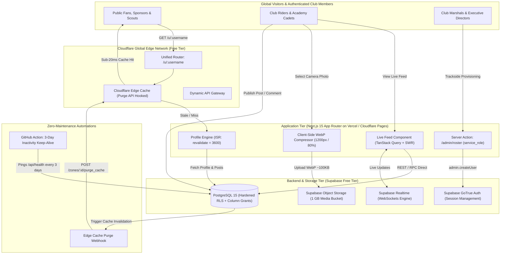

# BMCA Public Profiles & Social Platform: Technical Architecture Specification (v2.1 Production-Ready)

> **Target Systems:** Bangladesh Motocross Club & Academy (BMCA)  
> **Specification Document:** `docs/architecture_for_profiles.md`  
> **Operating Budget:** **$0.00 / month** (Guaranteed permanent operation within generous free tiers)  
> **Key Architectural Pillars:** Unified canonical vanity URLs (`/u/:username`) with role badges, Supabase Free 1 GB Storage with client-side WebP compression, hardened PostgreSQL Row-Level Security (RLS), edge cache synchronization, and trackside mobile admin provisioning.

---

## 1. Executive Summary & Core Design Philosophy

The BMCA Profiles & Social Platform delivers a high-speed, modern, public-facing digital community for Bangladesh's premier motocross academy and racing club. 

```
                                  BMCA ECOSYSTEM ARCHITECTURE
                                  
     [ Public Marketing Hub ]                       [ BMCA Paddock & Community ]
     (Static / GitHub Pages)                        (Next.js 15 + Supabase + Edge)
   https://bdmotocross.com                        https://paddock.bdmotocross.com (or /u/*)
  ┌─────────────────────────┐                   ┌────────────────────────────────────────┐
  │ • Fixture Countdown     │                   │ • Unified Rider Profiles (/u/:username)│
  │ • Academy Curriculum    │                   │ • High-Octane Public Feed & Comments   │
  │ • Sponsor Showcase      │                   │ • Native 1200px WebP Photos (<120 KB)  │
  │ • WhatsApp Registration ├──────────┐        │ • YouTube Widescreen Facades           │
  └─────────────────────────┘          │        │ • Direct Mentor WhatsApp Inquiries     │
                                       ▼        └────────────────────────────────────────┘
                       [ Off-Platform Communications ]
                     ┌──────────────────────────────────┐
                     │ • Direct Mentor WhatsApp (1-to-1)│
                     │ • BMCA Facebook Messenger Group  │
                     └──────────────────────────────────┘
```

### Core Tenets
1. **100% Public Access by Design:** Every post, comment, user mention, and rider profile is publicly indexable and viewable without paywalls or login walls.
2. **Unified Canonical Namespace (`/u/:username`):** Eliminates link rot on promotions and cleanly accommodates dual roles (e.g., Club Director MR99 who is also an active Pro Champion). Dynamic badges (`[DIRECTOR]`, `[HEAD COACH]`, `[PRO RACER]`, `[CADET]`) reflect status without fragmenting URLs. Backwards-compatible 301 redirects preserve legacy `/exec/*` and `/rider/*` links.
3. **Native Free-Tier Media Storage (Supabase 1 GB):** Replaces broken 24-hour Discord CDN tokens and blocked Imgur hotlinking with native photo uploads stored in Supabase's free 1 GB bucket. Client-side canvas/WebP compression enforces max 1200px dimensions (~80–120 KB per photo), fitting 8,000–12,000 photos for $0.00.
4. **Hardened Defense-in-Depth Security:** Column-level write restrictions and database triggers block privilege escalation attacks (`role = 'exec'`). `must_change_password` is enforced at the PostgreSQL RLS policy level, rendering direct REST API bypass impossible.
5. **Separation of Interactive Feed vs. Cached Profiles:** Vanity profile pages utilize Next.js 15 Incremental Static Regeneration (ISR) with Cloudflare Cache Purge hooks. The live interactive feed connects directly via Supabase Realtime to prevent out-of-sync parent post DOM errors.
6. **Trackside Mobile Administration (`/admin/roster`):** Eliminates CLI requirements. Club marshals and directors provision rider accounts on mobile devices via a secure Next.js Server Action powered by the Supabase `service_role`.
7. **Direct WhatsApp Mentor Routing:** 1-to-1 coaching inquiries route to BMCA's verified WhatsApp hotline (`+8801975376114`) and mentor numbers, keeping the Facebook Messenger group dedicated to broadcast announcements.

---

## 2. System Architecture & Component Interactions



---

## 3. URL Architecture & Unified Namespaces

### 3.1 The Unified Profile Namespace (`/u/:username`)
Rather than segregating users into `/exec/` and `/rider/`, all members share the canonical namespace `/u/:username` (or `/@:username`).

```
Canonical URL: https://bdmotocross.com/u/mr99
Displayed Badges: [CLUB DIRECTOR] [PRO TRACK CHAMPION]
```

#### Why This Eliminates Architectural Debt:
1. **Dual Roles Supported Natively:** Directors and mentors who actively race (e.g., Md. Mahabubur Rahman Hafiz / MR99) display both administrative credentials and racing honors on one unified page.
2. **Permanent Link Integrity (Zero Link Rot):** When an academy cadet (`/u/sharif_05`) graduates to a pro racer or mentor, their vanity URL remains unchanged. Stickers on dirt bike fenders, helmet decals, racing jersey prints, and Instagram bio links never break.
3. **Backwards Compatibility Engine:** Next.js middleware seamlessly maps legacy routes via 301 permanent redirects:
   - `/exec/:username` $\rightarrow$ `/u/:username` (301 Moved Permanently)
   - `/rider/:username` $\rightarrow$ `/u/:username` (301 Moved Permanently)

### 3.2 Global Route Hierarchy
```
bdmotocross.com/ (or paddock.bdmotocross.com/)
├── u/
│   ├── mr99                    -> Canonical Public Profile (Director & Pro Racer)
│   ├── baundal_bulbul          -> Canonical Public Profile (Mentor & Enduro Coach)
│   └── sharif_05               -> Canonical Public Profile (Pro Category Cadet)
├── feed/                       -> Live Public Activity Feed
├── login/                      -> Credential Authentication
├── settings/                   -> Rider Profile & Password Management
└── admin/
    └── roster/                 -> Trackside Mobile Provisioning Panel (Execs Only)
```

---

## 4. Hardened PostgreSQL Schema & Row-Level Security (RLS)

### 4.1 Complete Database DDL
```sql
-- 1. Enums & Custom Types
CREATE TYPE user_role AS ENUM ('exec', 'mentor', 'pro_racer', 'cadet', 'rider');
CREATE TYPE media_type AS ENUM ('none', 'image', 'youtube');

-- 2. Profiles Table
CREATE TABLE public.profiles (
    id UUID PRIMARY KEY REFERENCES auth.users(id) ON DELETE CASCADE,
    username VARCHAR(32) NOT NULL UNIQUE CHECK (username ~ '^[a-z0-9_]{3,32}$'),
    full_name VARCHAR(100) NOT NULL,
    role user_role NOT NULL DEFAULT 'rider',
    secondary_role user_role NULL,
    racing_number VARCHAR(10),
    bike_model VARCHAR(100),
    bio TEXT DEFAULT '',
    avatar_url TEXT DEFAULT '',
    banner_url TEXT DEFAULT '',
    whatsapp_number VARCHAR(20),
    must_change_password BOOLEAN NOT NULL DEFAULT TRUE,
    created_at TIMESTAMPTZ NOT NULL DEFAULT timezone('utc'::text, now()),
    updated_at TIMESTAMPTZ NOT NULL DEFAULT timezone('utc'::text, now())
);

CREATE INDEX idx_profiles_role ON public.profiles (role);

-- 3. Posts Table
CREATE TABLE public.posts (
    id UUID PRIMARY KEY DEFAULT gen_random_uuid(),
    author_id UUID NOT NULL REFERENCES public.profiles(id) ON DELETE CASCADE,
    content TEXT NOT NULL CHECK (char_length(content) <= 1000),
    media_type media_type NOT NULL DEFAULT 'none',
    media_url TEXT DEFAULT '',
    created_at TIMESTAMPTZ NOT NULL DEFAULT timezone('utc'::text, now())
);

CREATE INDEX idx_posts_created_at ON public.posts (created_at DESC);
CREATE INDEX idx_posts_author ON public.posts (author_id);

-- 4. Comments Table
CREATE TABLE public.comments (
    id UUID PRIMARY KEY DEFAULT gen_random_uuid(),
    post_id UUID NOT NULL REFERENCES public.posts(id) ON DELETE CASCADE,
    author_id UUID NOT NULL REFERENCES public.profiles(id) ON DELETE CASCADE,
    content TEXT NOT NULL CHECK (char_length(content) <= 500),
    created_at TIMESTAMPTZ NOT NULL DEFAULT timezone('utc'::text, now())
);

CREATE INDEX idx_comments_post_id ON public.comments (post_id, created_at ASC);

-- 5. Post Mentions (@tags) Table
CREATE TABLE public.post_mentions (
    post_id UUID NOT NULL REFERENCES public.posts(id) ON DELETE CASCADE,
    user_id UUID NOT NULL REFERENCES public.profiles(id) ON DELETE CASCADE,
    created_at TIMESTAMPTZ NOT NULL DEFAULT timezone('utc'::text, now()),
    PRIMARY KEY (post_id, user_id)
);

CREATE INDEX idx_mentions_user ON public.post_mentions (user_id);
```

### 4.2 Automated Trigger with Resilient Fallbacks
```sql
CREATE OR REPLACE FUNCTION public.handle_new_user()
RETURNS trigger AS $$
BEGIN
  INSERT INTO public.profiles (
    id,
    username,
    full_name,
    role,
    must_change_password
  )
  VALUES (
    new.id,
    LOWER(COALESCE(NULLIF(new.raw_user_meta_data->>'username', ''), 'rider_' || SUBSTRING(new.id::text, 1, 8))),
    COALESCE(NULLIF(new.raw_user_meta_data->>'full_name', ''), 'BMCA Member'),
    COALESCE(NULLIF(new.raw_app_meta_data->>'role', '')::user_role, 'rider'::user_role),
    TRUE
  );
  RETURN new;
END;
$$ LANGUAGE plpgsql SECURITY DEFINER;

CREATE TRIGGER on_auth_user_created
  AFTER INSERT ON auth.users
  FOR EACH ROW EXECUTE PROCEDURE public.handle_new_user();

-- Automated trigger to release must_change_password lock upon password reset
CREATE OR REPLACE FUNCTION public.handle_password_changed()
RETURNS trigger AS $$
BEGIN
  IF (OLD.encrypted_password IS DISTINCT FROM NEW.encrypted_password) THEN
    UPDATE public.profiles
    SET must_change_password = FALSE
    WHERE id = NEW.id;
  END IF;
  RETURN NEW;
END;
$$ LANGUAGE plpgsql SECURITY DEFINER;

CREATE TRIGGER on_auth_user_password_changed
  AFTER UPDATE OF encrypted_password ON auth.users
  FOR EACH ROW EXECUTE PROCEDURE public.handle_password_changed();
```

---

## 5. Security Hardening & Privilege Protection

### 5.1 Column-Level Privilege Revocation (Defense Against Self-Elevation)
To prevent malicious cadets from issuing raw REST requests (`PATCH /rest/v1/profiles`) to promote themselves to `exec` or bypass `must_change_password`:

```sql
-- Revoke all update privileges on profiles from normal authenticated users
REVOKE UPDATE ON public.profiles FROM authenticated;

-- Whitelist only benign profile fields for rider editing
GRANT UPDATE (full_name, racing_number, bike_model, bio, avatar_url, banner_url, whatsapp_number)
ON public.profiles TO authenticated;

-- BEFORE UPDATE Trigger guarding system fields as defense-in-depth
CREATE OR REPLACE FUNCTION public.protect_profile_system_fields()
RETURNS trigger AS $$
BEGIN
  IF (NEW.role IS DISTINCT FROM OLD.role) OR 
     (NEW.secondary_role IS DISTINCT FROM OLD.secondary_role) OR 
     (NEW.must_change_password IS DISTINCT FROM OLD.must_change_password) THEN
    -- Only service_role (Admin Actions) can modify system fields
    IF (current_setting('request.jwt.claim.role', true) != 'service_role') THEN
      RAISE EXCEPTION 'Unauthorized attempt to modify protected system fields.';
    END IF;
  END IF;
  NEW.updated_at = timezone('utc'::text, now());
  RETURN NEW;
END;
$$ LANGUAGE plpgsql SECURITY DEFINER;

CREATE TRIGGER trg_protect_profile_system_fields
  BEFORE UPDATE ON public.profiles
  FOR EACH ROW EXECUTE PROCEDURE public.protect_profile_system_fields();
```

### 5.2 Server-Enforced Password Change Gate
```sql
-- Helper function to verify user is active and has completed password change
CREATE OR REPLACE FUNCTION public.is_active_member(user_id UUID)
RETURNS BOOLEAN AS $$
  SELECT EXISTS (
    SELECT 1 FROM public.profiles
    WHERE id = user_id AND must_change_password = FALSE
  );
$$ LANGUAGE sql SECURITY DEFINER STABLE;

-- Helper function to verify executive permissions (checks primary and secondary roles)
CREATE OR REPLACE FUNCTION public.is_club_exec(user_id UUID)
RETURNS BOOLEAN AS $$
  SELECT EXISTS (
    SELECT 1 FROM public.profiles
    WHERE id = user_id AND (role = 'exec' OR secondary_role = 'exec')
  );
$$ LANGUAGE sql SECURITY DEFINER STABLE;
```

### 5.3 Bulletproof Row-Level Security (RLS) Policies
```sql
ALTER TABLE public.profiles ENABLE ROW LEVEL SECURITY;
ALTER TABLE public.posts ENABLE ROW LEVEL SECURITY;
ALTER TABLE public.comments ENABLE ROW LEVEL SECURITY;
ALTER TABLE public.post_mentions ENABLE ROW LEVEL SECURITY;

-- PROFILES
CREATE POLICY "Public read access for profiles"
ON public.profiles FOR SELECT USING (true);

CREATE POLICY "Users can update permitted fields on own profile"
ON public.profiles FOR UPDATE TO authenticated
USING (auth.uid() = id)
WITH CHECK (auth.uid() = id);

-- POSTS
CREATE POLICY "Public read access for posts"
ON public.posts FOR SELECT USING (true);

CREATE POLICY "Active members can create posts"
ON public.posts FOR INSERT TO authenticated
WITH CHECK (
  auth.uid() = author_id 
  AND public.is_active_member(auth.uid())
);

CREATE POLICY "Authors and Admins can delete posts"
ON public.posts FOR DELETE TO authenticated
USING (
  auth.uid() = author_id 
  OR public.is_club_exec(auth.uid())
);

-- COMMENTS
CREATE POLICY "Public read access for comments"
ON public.comments FOR SELECT USING (true);

CREATE POLICY "Active members can post comments"
ON public.comments FOR INSERT TO authenticated
WITH CHECK (
  auth.uid() = author_id 
  AND public.is_active_member(auth.uid())
);

CREATE POLICY "Authors and Admins can delete comments"
ON public.comments FOR DELETE TO authenticated
USING (
  auth.uid() = author_id 
  OR public.is_club_exec(auth.uid())
);

-- MENTIONS
CREATE POLICY "Public read access for mentions"
ON public.post_mentions FOR SELECT USING (true);

CREATE POLICY "Post authors can link mentions"
ON public.post_mentions FOR INSERT TO authenticated
WITH CHECK (
  EXISTS (
    SELECT 1 FROM public.posts 
    WHERE id = post_id AND author_id = auth.uid()
  )
);

-- STORAGE BUCKET & RLS POLICIES (1 GB Free Object Storage)
INSERT INTO storage.buckets (id, name, public, file_size_limit, allowed_mime_types)
VALUES ('paddock-media', 'paddock-media', true, 2097152, ARRAY['image/webp', 'image/jpeg', 'image/png'])
ON CONFLICT (id) DO NOTHING;

CREATE POLICY "Public read for paddock media"
ON storage.objects FOR SELECT USING (bucket_id = 'paddock-media');

CREATE POLICY "Active members can upload paddock media"
ON storage.objects FOR INSERT TO authenticated
WITH CHECK (
  bucket_id = 'paddock-media' 
  AND public.is_active_member(auth.uid())
  AND (storage.foldername(name))[1] = auth.uid()::text
);

CREATE POLICY "Authors can delete their uploaded media"
ON storage.objects FOR DELETE TO authenticated
USING (
  bucket_id = 'paddock-media' 
  AND (storage.foldername(name))[1] = auth.uid()::text
);
```

---

## 6. Zero-Cost Media Architecture: Native WebP + YouTube Widescreen

### 6.1 Native Image Uploads via Supabase Free Storage (1 GB)
Instead of relying on fragile Discord CDN attachments (which expire in 24 hours) or Imgur (which blocks hotlinking), the platform leverages Supabase's native free **1 GB Object Storage**.

#### Client-Side Compression Pipeline
Before uploading, the browser resizes photos using standard HTML5 Canvas:
- **Maximum Resolution:** 1200px width/height.
- **Format:** Optimized `.webp` (quality: 0.82).
- **Target File Size:** ~80 KB to 120 KB per image.
- **Storage Capacity:** 1,000 MB / 0.1 MB = **~10,000 photos hosted permanently for $0.00**.

```typescript
// utils/compressImage.ts
export async function compressRiderImage(file: File): Promise<Blob> {
  return new Promise((resolve, reject) => {
    const img = new Image();
    img.src = URL.createObjectURL(file);
    img.onload = () => {
      const canvas = document.createElement('canvas');
      const MAX_SIZE = 1200;
      let width = img.width;
      let height = img.height;

      if (width > height && width > MAX_SIZE) {
        height = Math.round((height * MAX_SIZE) / width);
        width = MAX_SIZE;
      } else if (height > MAX_SIZE) {
        width = Math.round((width * MAX_SIZE) / height);
        height = MAX_SIZE;
      }

      canvas.width = width;
      canvas.height = height;
      const ctx = canvas.getContext('2d');
      ctx?.drawImage(img, 0, 0, width, height);

      canvas.toBlob(
        (blob) => {
          if (blob) resolve(blob);
          else reject(new Error('Canvas compression failed'));
        },
        'image/webp',
        0.82
      );
    };
    img.onerror = (err) => reject(err);
  });
}
```

### 6.2 Robust 16:9 Widescreen YouTube Facade
Fixes letterboxing by requesting WebP thumbnails (`maxresdefault.webp`) and provides screen-reader accessibility:

```tsx
// components/YouTubeEmbed.tsx
"use client";

import { useState } from "react";

interface YouTubeEmbedProps {
  videoId: string;
  title?: string;
}

export function YouTubeEmbed({ videoId, title = "BMCA Motocross Track Video" }: YouTubeEmbedProps) {
  const [isPlaying, setIsPlaying] = useState(false);
  const [thumbSrc, setThumbSrc] = useState(
    `https://i.ytimg.com/vi_webp/${videoId}/maxresdefault.webp`
  );

  if (isPlaying) {
    return (
      <div className="relative aspect-video w-full rounded-xl overflow-hidden shadow-2xl bg-black">
        <iframe
          src={`https://www.youtube-nocookie.com/embed/${videoId}?autoplay=1&rel=0`}
          title={title}
          allow="accelerometer; autoplay; clipboard-write; encrypted-media; gyroscope; picture-in-picture"
          allowFullScreen
          className="w-full h-full border-0"
        />
      </div>
    );
  }

  return (
    <button
      onClick={() => setIsPlaying(true)}
      className="relative aspect-video w-full rounded-xl overflow-hidden group cursor-pointer bg-neutral-900 focus:outline-none focus:ring-2 focus:ring-rose-600"
      aria-label={`Play: ${title}`}
    >
       setThumbSrc(`https://img.youtube.com/vi/${videoId}/hqdefault.jpg`)}
        className="w-full h-full object-cover group-hover:scale-105 transition-transform duration-500"
      />
      <div className="absolute inset-0 bg-gradient-to-t from-black/80 via-black/20 to-transparent flex items-center justify-center">
        <div className="w-16 h-16 rounded-full bg-rose-600/90 text-white flex items-center justify-center shadow-xl group-hover:scale-110 group-hover:bg-rose-600 transition-all">
          <svg className="w-8 h-8 fill-current ml-1" viewBox="0 0 24 24">
            <path d="M8 5v14l11-7z" />
          </svg>
        </div>
      </div>
    </button>
  );
}
```

---

## 7. Edge Caching & Realtime Feed Synchronization

### 7.1 Separation of Concerns: Profiles vs. Live Feed
To eliminate the synchronization error where live WebSocket comments arrive for parent posts not yet present in the 60s Edge Cache:

| Surface | Rendering Model | Caching Strategy | Data Synchronization |
| :--- | :--- | :--- | :--- |
| **Rider Profiles (`/u/:username`)** | Static Generation (ISR) | Edge Cached for 3,600s (`s-maxage=3600`) | Revalidated on profile edit via Cloudflare Purge Hook |
| **Activity Feed (`/feed`)** | Dynamic Client View | **No Edge Cache** (Direct Supabase REST / RPC) | Synced instantaneously via Supabase Realtime WebSockets |

### 7.2 Automated Cloudflare Cache Invalidation
When an executive updates track credentials or a rider changes their setup, Next.js calls the Cloudflare Cache Purge API to synchronize edge nodes immediately:

```typescript
// app/actions/purgeProfileCache.ts
"use server";

import { revalidatePath } from "next/cache";

export async function purgeEdgeProfileCache(username: string) {
  const cleanUser = username.toLowerCase().trim();
  
  // 1. Invalidate Next.js internal ISR cache
  revalidatePath(`/u/${cleanUser}`);

  // 2. Invalidate Cloudflare Edge CDN Cache
  const zoneId = process.env.CLOUDFLARE_ZONE_ID;
  const apiToken = process.env.CLOUDFLARE_API_TOKEN;
  const appDomain = process.env.NEXT_PUBLIC_APP_DOMAIN || "paddock.bdmotocross.com";
  const url = `https://${appDomain}/u/${cleanUser}`;

  if (!zoneId || !apiToken) return;

  try {
    await fetch(`https://api.cloudflare.com/client/v4/zones/${zoneId}/purge_cache`, {
      method: "POST",
      headers: {
        "Content-Type": "application/json",
        Authorization: `Bearer ${apiToken}`,
      },
      body: JSON.stringify({ files: [url] }),
    });
  } catch (error) {
    console.error("Cloudflare purge error:", error);
  }
}
```

---

## 8. Trackside Operations & Club Realities

### 8.1 Mobile Admin Panel (`/admin/roster`)
Instead of expecting marshals to run terminal commands trackside, directors provision accounts through an authenticated mobile view guarded by executive authorization:

```typescript
// app/actions/provisionRider.ts
"use server";

import { createClient } from "@/utils/supabase/server";
import { createClient as createAdminClient } from "@supabase/supabase-js";
import { revalidatePath } from "next/cache";

const supabaseAdmin = createAdminClient(
  process.env.NEXT_PUBLIC_SUPABASE_URL!,
  process.env.SUPABASE_SERVICE_ROLE_KEY!
);

export async function provisionRiderAccount(formData: FormData) {
  // 1. Authenticate caller session & enforce executive authority
  const supabase = await createClient();
  const { data: { user } } = await supabase.auth.getUser();
  if (!user) throw new Error("Unauthorized");

  const { data: caller } = await supabase
    .from("profiles")
    .select("role, secondary_role")
    .eq("id", user.id)
    .single();

  if (caller?.role !== "exec" && caller?.secondary_role !== "exec") {
    throw new Error("Forbidden: Executive authority required.");
  }

  // 2. Validate and sanitize inputs
  const rawUsername = (formData.get("username") as string).toLowerCase().trim();
  if (!/^[a-z0-9_]{3,32}$/.test(rawUsername)) {
    throw new Error("Invalid username. Use 3-32 lowercase letters, numbers, or underscores.");
  }

  const fullName = (formData.get("fullName") as string).trim();
  const role = (formData.get("role") as string) || "rider";
  const tempPassword = formData.get("tempPassword") as string;
  const email = `${rawUsername}@members.bdmotocross.com`; // Virtual routing address

  // 3. Create auth user with service_role privileges
  const { data: newUser, error: authError } = await supabaseAdmin.auth.admin.createUser({
    email,
    password: tempPassword,
    email_confirm: true,
    user_metadata: { username: rawUsername, full_name: fullName },
    app_metadata: { role }, // server-only; user_metadata is client-writable
  });

  if (authError) throw new Error(authError.message);

  revalidatePath("/admin/roster");
  return { success: true, username: rawUsername, tempPassword };
}
```

#### Client Login Form Resolution Contract (`/login`)
When members log in, the client form automatically normalizes entered usernames into the virtual routing email address:
```typescript
// app/login/page.tsx
const email = inputUsername.includes("@")
  ? inputUsername.trim()
  : `${inputUsername.toLowerCase().trim()}@members.bdmotocross.com`;

const { error } = await supabase.auth.signInWithPassword({
  email,
  password,
});
```

### 8.2 Inactivity Auto-Pause Prevention (GitHub Action Keep-Alive)
Supabase Free Tier auto-pauses instances after 7 days of inactivity. To protect against season lulls between motocross championships, a GitHub Actions cron job pings the database every 72 hours:

```yaml
# .github/workflows/keep-alive.yml
name: Keep-Alive Database Ping
on:
  schedule:
    - cron: '0 0 */3 * *' # Every 3 days at midnight UTC
  workflow_dispatch:

jobs:
  ping-supabase:
    runs-on: ubuntu-latest
    steps:
      - name: Send Keep-Alive Ping
        run: |
          curl -f -X GET "${{ secrets.SUPABASE_URL }}/rest/v1/profiles?select=id&limit=1" \
               -H "apikey: ${{ secrets.SUPABASE_ANON_KEY }}" \
               -H "Authorization: Bearer ${{ secrets.SUPABASE_ANON_KEY }}"
```

### 8.3 1-to-1 Mentor Routing via Direct WhatsApp
Rather than crowding a group chat for coaching questions, profile cards feature direct WhatsApp triggers linking to mentors:

```tsx
// components/MentorContactButton.tsx
export function MentorContactButton({ 
  mentorName, 
  whatsappNumber = "+8801975376114" 
}: { 
  mentorName: string; 
  whatsappNumber?: string;
}) {
  const cleanNumber = whatsappNumber.replace(/[^0-9]/g, "");
  const text = encodeURIComponent(
    `Hello BMCA, I would like to book a coaching session with mentor ${mentorName}.`
  );

  return (
    <a
      href={`https://wa.me/${cleanNumber}?text=${text}`}
      target="_blank"
      rel="noopener noreferrer"
      className="inline-flex items-center gap-2 px-4 py-2 bg-emerald-600 hover:bg-emerald-500 text-white font-semibold rounded-lg shadow-md transition-colors"
    >
      <span>Contact on WhatsApp</span>
    </a>
  );
}
```

---

## 9. Migration & Deployment Strategy

To preserve the existing static marketing website (`website/` deployed via GitHub Pages) without risky disruptions:

```
                               DEPLOYMENT MODES
                               
  Option A: Subdomain Topology (Recommended)
  ──────────────────────────────────────────
  • bdmotocross.com           -> Existing GitHub Pages site (Landing, Fixtures, Gallery)
  • paddock.bdmotocross.com   -> Next.js 15 Community App (Profiles, Feed, Media)
  • Advantages: Zero migration risk, completely decoupled release cycles.

  Option B: Unified Monolith
  ──────────────────────────
  • bdmotocross.com           -> Full Next.js 15 App hosted on Cloudflare Pages / Vercel
  • Route groups: app/(marketing) and app/(paddock)
  • Advantages: Single domain for everything; requires converting HTML/JS to React components.
```

### Recommended Strategy: Subdomain Topology (`paddock.bdmotocross.com`) — LIVE & DEPLOYED
1. `website/` deployed to GitHub Pages at `https://bdmotocross.com` with Namecheap BasicDNS and HTTPS enforced.
2. Next.js 16 platform deployed on Vercel at `https://paddock.bdmotocross.com` with Supabase integration.
3. Master database schema deployed via `paddock/supabase/full_setup.sql` (migrations 0001–0005).
4. Vanity links share cleanly: `paddock.bdmotocross.com/u/mr99`.
5. "Paddock ↗" navigation link in `website/index.html` connects visitors from the marketing site to the community platform.

---

## 10. Cost & Limits Matrix ($0.00 Budget Verification)

| Platform Component | Free Tier Capacity | Expected BMCA Demand | Operating Cost |
| :--- | :--- | :--- | :--- |
| **Supabase PostgreSQL** | 500 MB relational storage | ~15 MB (millions of text posts) | **$0.00** |
| **Supabase Object Storage** | 1,000 MB (1 GB) storage | ~10,000 compressed WebP photos | **$0.00** |
| **Supabase Storage Egress** | 2,000 MB (2 GB) / month | Cloudflare edge caches images | **$0.00** |
| **Supabase Auth** | 50,000 Monthly Active Users | ~300 verified club accounts | **$0.00** |
| **Cloudflare Edge CDN** | Unlimited requests & bandwidth | Absorbs 99% of profile reads | **$0.00** |
| **GitHub Actions** | 2,000 free runner mins / month | 2 mins / week for keep-alive | **$0.00** |
| **Total Operating Cost** | | | **$0.00 / month** |

## WhatsApp number visibility (migration 0005)

Each member decides whether their WhatsApp number is public. RLS filters rows, not columns, and `profiles` is world-readable, so `profiles.whatsapp_number` moved to `profile_contacts (profile_id, whatsapp_number, whatsapp_public)`. A row is visible to its owner, and to everyone (anon included) only when `whatsapp_public` is true. Only the owner can insert, update or delete it. Existing numbers migrate as private. `/u/[username]` reads it with the anon client, so the ISR page only ever caches public numbers; saving settings purges the page. Check: `paddock/supabase/tests/rls_check.sql`.
